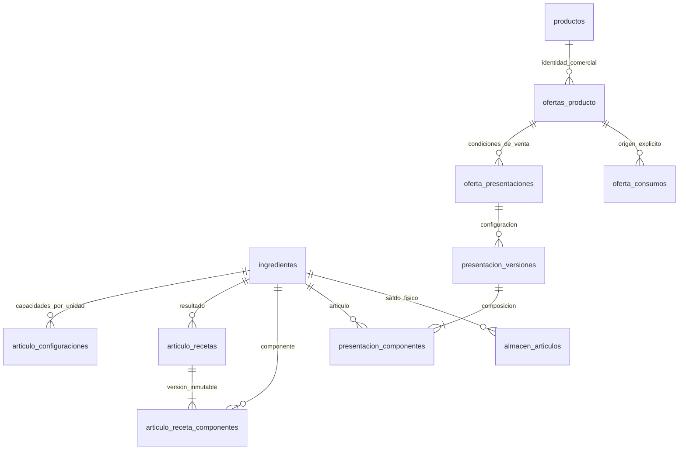
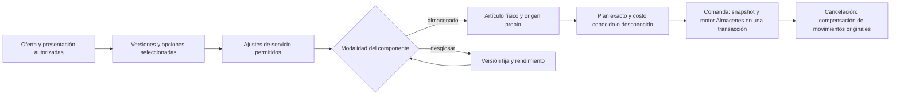

# Arquitectura de Casa Pestalozzi

## Estado A4: menú independiente por negocio

A4 retira Productos de la casa como funcionalidad operativa. Global no administra
productos comerciales, ofertas, publicaciones, políticas, personalizaciones,
recetas oficiales ni presentaciones oficiales. Restaurante y Panadería gestionan
sus ofertas y datos comerciales desde su propio contexto, con autorización local.
Global conserva `productos` para Artículos y preparaciones, además de Inventario,
Usuarios, Transferencias y las funciones transversales habilitadas.

`oferta_datos_comerciales` es la fuente de nombre, descripción e imagen de cada
oferta; `productos_oferta` conserva su interfaz compatible de lectura desde esa
fuente. Las ofertas mantienen precio, disponibilidad, categoría, área y orden.
La asociación comercial cruzada no se ofrece como operación nueva. No se crean
recetas automáticamente al registrar una oferta.

Recetas, versiones de presentaciones, variantes, ajustes, referencias de artículos,
almacenes y snapshots existentes permanecen intactos. Las recetas derivadas de un
estándar son recetas locales versionadas y continúan utilizándose en ventas; una
edición crea una nueva versión local. Las presentaciones heredadas usan su
configuración local válida y no consultan `presentacion_estandares` durante una
venta. Las tablas y triggers de publicación permanecen como historia, sin
autoridad sobre las operaciones vigentes. A4 no elimina datos ni aplica cambios a
la base operativa.

**Contexto histórico: cierre 3E, previo a A4 · 25 de octubre de 2026**

M0 integra segundo factor administrativo por privilegios efectivos (superadmin
y permisos directos de panel), JWT HS256 para integraciones entrantes y corte
de caja por turnos de Restaurante. M1 añadió administración local de Menú en los
negocios y M1.2 añadió temporalmente Productos de la casa; A4 retiró la parte
comercial Global, como establece el estado rector al inicio de este documento.
Los contratos detallados se desarrollan en [credenciales](usuarios/credenciales.md),
[API](../API.md#9-jwt-de-integraciones) y [operación](operacion.md#corte-de-caja-por-turnos).
La [landing pública de Panadería](panaderia/landing.md) muestra la vitrina del
menú y ofrece contacto por WhatsApp para encargos; no implementa pedidos ni
ventas en línea. Sus rutas de sección redirigen a la landing.

Este documento es la única fuente normativa para alcance, arquitectura, propiedad, seguridad, datos y reglas de desarrollo. Describe la implementación de esta revisión: una entidad o pantalla existente por sí sola no significa que un módulo esté funcional. Las guías enlazadas explican procedimientos y detalles técnicos subordinados; si una referencia contradice estas decisiones, debe actualizarse antes de ampliar el módulo.

## 1. Objetivo y alcance

Casa Pestalozzi es una aplicación web PHP 8 MVC con MySQL. Una identidad compartida puede trabajar en tres ámbitos: Global, Restaurante y Panadería. Global es administrativo y no vende. Restaurante y Panadería son negocios distintos con oferta, almacenes, operaciones comerciales y finanzas propias.

Usuarios y Almacenes funcionan en los tres ámbitos; Restaurante conserva su
operación comercial y Panadería administra su menú y recetas locales. La caja
de mostrador de Panadería (§7) vende, cobra, registra horneadas y anula cobros
del día; la producción física sigue pendiente. Finanzas y Análisis ofrecen
comparativos Global de solo lectura. Una tabla, ruta o elemento de menú no
convierte un módulo pendiente en flujo liberado.

## 2. Arquitectura de aplicación

El flujo principal es `HTTP → Router / Auth → Controller → Service → Model → MySQL`; el Controller prepara una View HTML o una respuesta JSON. PHP MVC es propio, sin framework ni ORM. `public/index.php` registra rutas exactas; `Router.php` despacha. Composer registra `Controllers\\`, `Model\\`, `Classes\\`, `MVC\\` y `Services\\`.

- **Controller:** aplica controles HTTP, CSRF y validación estructural; coordina un caso de uso. No contiene reglas de negocio ni consultas complejas.
- **Service:** es la autoridad de casos de uso, reglas, autorizaciones de recurso y transacciones. Puede coordinar servicios de otros dominios mediante una frontera definida.
- **Model:** persiste y representa datos. No depende de Controllers, Views ni Services.
- **View:** presenta datos preparados; no consulta base de datos, Models ni Services.
- **Presenter/Serializer:** proyecta hechos ya resueltos; no vuelve a calcular reglas de negocio.
- **Integrations:** adaptan servicios externos; no son fuente de reglas ni de identidad.

Usar consultas preparadas y listas permitidas para identificadores SQL dinámicos. No introducir reescritura SQL, doble escritura de stock ni compatibilidad nueva con estructuras históricas descartadas.

## 3. Ámbitos, propiedad y estado de módulos

`unidades.slug` es la identidad estable del ámbito. No se infiere propiedad con un ID numérico, nombre enviado por el navegador ni selector visual. La sesión selecciona contexto, pero el servidor vuelve a cargar membresías, estado y permisos en cada petición y valida también detalles, listados, filtros, exportaciones, PDFs e integraciones.

| Módulo | Global | Restaurante | Panadería |
|---|---|---|---|
| Usuarios | Funcional: administra ámbitos delegados y privilegios dentro del techo autorizado | Funcional: administración local | Funcional: administración local con UI compartida |
| Almacenes e inventario | Funcional: maestro, almacenes propios, asignación, lectura consolidada, operaciones autorizadas en sus físicos y confirmación de regularizaciones que salen de ellos | Funcional: almacenes propios, artículos, entradas, ajustes, mermas, movimientos, faltantes por conciliar y alertas | Funcional: mismas operaciones locales, aisladas por propietario |
| Catálogo maestro | Funcional para administrar artículos organizacionales | Consulta/uso autorizado en recetas e inventario | Consulta/uso autorizado en recetas e inventario |
| Menú y ofertas | Sin módulo comercial; consulta PDF con permisos Global y del dueño (ver §15) | Menú, ofertas y escritura comercial local | Menú, ofertas y escritura comercial local |
| Recetas y variantes | Preparaciones de artículos compartidos; sin ofertas comerciales | Recetas operativas versionadas y variantes locales | Recetas operativas versionadas y variantes locales; integración de presentaciones a caja pendiente |
| Reservaciones, mesas y KDS | No aplica | Flujos existentes funcionales | No implementados |
| POS, tickets y pagos | No vende; consolidación operativa pendiente | Flujos existentes funcionales | Funcional: caja de mostrador sin mesas (`/panaderia/caja`), cobro en efectivo o tarjeta, horneadas, anulación del día y corte de consulta (§7) |
| Finanzas y analítica | Finanzas y Análisis: comparativos de sólo lectura de los dos negocios (Finanzas: hoy, periodo y total; Análisis: ventas, tickets, indicadores y productos más vendidos por negocio), sin ventas ni gastos propios | Flujos existentes conservados; validar límites en su guía | Finanzas y Análisis funcionales con métricas de caja (mapa de calor de venta en lugar de RevPASH) sobre los tickets de la caja |
| Proveedores | Funcional: directorio propio para sus almacenes y consulta consolidada de los tres; no edita los de un negocio | Funcional: directorio, artículos que surte, entradas ligadas e histórico | Funcional: mismas operaciones locales, aisladas por propietario |
| Asistente IA | Funcional: consultas preensambladas del consolidado de almacenes y transferencias; sin ventas | Funcional: consultas preensambladas de ventas, equipo e inventario | Funcional: consultas preensambladas de ventas en caja, almacenes y menú, sobre los tickets de la caja |
| Transferencias | Motor y UI compartidos M0.5-B; operación física propia | Motor y UI compartidos M0.5-B; operación física propia | Motor y UI compartidos M0.5-B; operación física propia |
| Producción y catering | Pendientes/fuera de 3E | Pendientes/fuera de 3E | Pendientes/fuera de 3E |

**Funcional** significa flujo respaldado por persistencia, autorización del servidor, interfaz o API real y pruebas de aceptación. **Preparado** significa que existen entidades o servicios parciales sin recorrido completo. **Pendiente** significa que el flujo no debe inferirse ni activarse por una ruta, tabla o fixture.

Global puede leer y consolidar datos según sus permisos; una vista consolidada nunca habilita escritura sobre un almacén, ticket o cuenta ajena. Restaurante y Panadería no comparten existencias comerciales por pertenecer a la misma organización.

## 4. Autenticación, autorización y Usuarios

La identidad es única y las membresías de `usuario_unidades` pueden combinar los tres ámbitos. Los permisos efectivos se guardan directamente en `usuario_unidad_permisos` por usuario, unidad y módulo; las facultades explícitas habilitan operaciones organizacionales concretas. No hay plantillas de permisos y un rol interno es metadato: no otorga acceso por sí solo.

En panel se usan `ver` y `editar`; `editar` incluye lectura. `operar` se limita a superficies de operación autorizadas, como POS, KDS y mapa de reservaciones. Si una identidad tiene acceso a cualquier panel administrativo en cualquier ámbito, exige contraseña. PIN/NIP se admite exclusivamente para el acceso de piso autorizado; una sesión de NIP no se convierte en sesión administrativa al cambiar el contexto o los permisos.

El servicio de Usuarios limita administración al ámbito delegado, aplica techos por módulo y facultad, valida el estado de cuenta y evita modificar el superadministrador o escalar privilegios desde campos del cliente. Revocar membresía o permiso afecta la siguiente petición protegida. La interfaz compartida no concede autorización. La gestión administrativa exige permiso de módulo y `usuarios.gestionar`; delegar permisos exige además `permisos.delegar`. No se implementan plantillas.

`usuarios.es_superadmin` es una excepción organizacional protegida. El CRUD ordinario no puede promover una cuenta. Las rutas privadas se clasifican expresamente; una ruta desconocida deniega en vez de quedar pública por omisión. Integraciones públicas conservan token o secreto propio. Mantener CSRF, limitación de intentos, HMAC para NIP, hashes seguros, no-store de credenciales efímeras y protección del último superadministrador activo.

La guía técnica está en [Usuarios](usuarios/usuarios.md), [permisos directos](usuarios/roles-y-permisos.md) y [credenciales](usuarios/credenciales.md); esta sección define el comportamiento que esas referencias deben respetar.

## 5. Almacenes e inventario

`ingredientes` es el catálogo maestro de artículos inventariables, distinto de `productos` comerciales. Un almacén es físico, tiene un único propietario (`unidad_id`) y estado. Solo Global con facultad `almacenes.crear` crea almacenes y asigna su propietario a Global, Restaurante o Panadería. `catalogo.editar` controla la administración del catálogo maestro. Cada negocio opera solo almacenes propios y autorizados.

`almacen_articulos` es la única fuente de saldo por almacén/artículo. No existe saldo maestro duplicado ni almacén virtual para consolidación. El saldo consolidado se consulta por artículo compatible y se desglosa por negocio y almacén; cantidades de unidades incompatibles no se suman. Mínimo, estado y versión pertenecen a la asociación física. **Ningún saldo es negativo** (M3, §16): la política «Permitir existencias negativas» se retiró; `almacenes.permitir_negativos` se conserva por compatibilidad fijado en 0 por un `CHECK`. Lo que una venta no encuentra en su almacén de consumo se registra como faltante pendiente de origen, nunca como saldo negativo.

`Almacenes` contiene el motor compartido; `AdministracionAlmacenes` coordina la interfaz, sin duplicar reglas ni saldos. Una operación registra la petición/idempotencia, movimientos inmutables, saldo y documento relacionado de forma atómica. Bloqueos ordenados/versiones evitan carreras y sobreescritura perdida. Entradas, mermas, consumos y compensaciones deben ser trazables. **No existe operación que sobrescriba un saldo** (8 nov 2026, auditoría A-4): el conteo físico y el ajuste rápido se retiraron porque fijaban el saldo con motivo operacion_administrativa y nota vacía, ignoraban los faltantes pendientes y no se distinguían de una merma. Una diferencia real se registra como merma con su motivo, o como entrada. Los movimientos juste ya registrados (conteos anteriores y la conversión de negativos de M3) se conservan como historial de sólo lectura; el ENUM no cambia. No reportar éxito antes del commit coordinador. Identificadores manipulados nunca permiten consultar ni modificar existencias ajenas.

Global consulta el inventario consolidado y opera únicamente sus propios almacenes. **Asociar y dar entrada entre negocios (9 nov 2026).** Asociar un artículo y registrar una entrada se autorizan en el negocio dueño del almacén, no en el contexto de la pantalla: quien ya tiene `inventario/editar` en ese negocio puede hacerlo desde cualquier pantalla de Almacenes (el superadministrador, en todos). No concede permisos nuevos, sólo evita cambiar de contexto; el motor recibe el contexto del dueño y vuelve a comprobar el permiso, y cada asociación y movimiento llevan la unidad dueña de su almacén. El alta de un artículo puede asociarlo a varios almacenes en la misma transacción, y «Asociar» acepta varios a la vez: todos o ninguno. Merma y configuración de la asociación siguen siendo del contexto actual. La justificación es de fricción: obligaba a cambiar de negocio para cada almacén de un mismo artículo. Una transferencia ya no exige asociación previa en el destino: recibir implica manejar el artículo, así que la crea con mínimo 0 y sin saldo, con la unidad dueña, y lo informa; en el origen sí se exige, porque sin asociación no hay existencias que enviar. Restaurante y Panadería asocian artículos, registran entradas, ajustes y mermas, consultan movimientos, alertas y totales, y concilian los faltantes de sus almacenes si tienen `inventario/editar`. Transferencias registra con contexto propietario. Dentro del mismo negocio, o cuando la registra el superadministrador, se aplica en un solo paso: salida y entrada en la misma transacción. Entre negocios distintos (Global, Restaurante y Panadería lo son entre sí) pasa por solicitada, enviada y recibida; si la registra el dueño del origen, nace enviada. Recepción parcial, incidencia y retorno son excepciones, no fases. El paso «autorizar» se retiró (8 nov 2026) porque no tenía efecto físico: comprobaba saldo sin reservarlo y el envío lo vuelve a comprobar. Detalle en su [contrato](modulos/transferencias.md). La caja de Panadería registra horneadas como entradas de piso acotadas a sus piezas de vitrina (§7); su venta descuenta la pieza con el mismo motor, así que tampoco deja saldo negativo: lo que falte queda como faltante. Producción y variantes avanzadas siguen pendientes. Referencia de pantalla: [Almacenes](modulos/almacenes.md).

## 6. Catálogo, productos, cartas, ofertas y menú preservado

`productos` contiene identidad descriptiva que puede compartirse. `ofertas_producto` representa una decisión comercial propia del negocio: precio, categoría, disponibilidad, orden y área de producción. Cartas, categorías, áreas, ofertas, recetas y variantes se validan en el ámbito correcto. No fusionar productos solo por nombre ni clonar una oferta de Restaurante en Panadería sin una decisión comercial explícita.

Las recetas/versiones, subrecetas y variantes pertenecen a la oferta. Los ajustes de variante identifican componentes concretos. Consultar una receta no permite acceder al inventario de otra unidad. Las ventas y el consumo resuelven el origen de stock del negocio vendedor sin fallback a otros almacenes. Ese origen (`oferta_consumos`) se elige a mano en la receta, con `productos/editar`, para cada artículo que la receta activa, sus subrecetas o las variantes que agregan o sustituyen pueden descontar, entre almacenes activos del negocio donde el artículo está asociado. Sin él, la comanda se rechaza completa: la falta de **origen configurado** sigue bloqueando; la falta de **saldo** ya no (§16).

Cada oferta declara un tipo de venta (`ofertas_producto.tipo_venta`): **preparado al momento** (receta o presentación, como copa de 150 ml o pasta) o **reventa** (una sola pieza o porción almacenada por unidad vendida, como una botella). El tipo es una regla de validación sobre composiciones que el motor ya entiende, no otro motor; su contrato está en §16.

El DML preserva el menú original de Restaurante: 112 productos y sus 112 ofertas, IDs y relaciones, 15 categorías, 3 cartas, 4 áreas de producción y disponibilidad/orden/precios/descripciones originales. Las 13 imágenes propias están versionadas y se sirven desde los assets de aplicación; el fallback de categoría continúa disponible. Los productos y ofertas sintéticos (IDs desde 1000, sin prefijos visibles) son adiciones independientes para escenarios de prueba y no alteran esos 112 registros. Panadería usa una oferta sintética propia en desarrollo, no una copia del menú real.

**Avisos de la carta (2 nov 2026).** `MenuPdf` es contrato compartido de la carta pública y de los PDF administrativos; se amplía sólo con un parámetro de avisos ya resueltos. `MenuPdf::documento()` compone la carta y `emitir()` la transmite, sin cambiar rutas, permisos ni nombres de archivo. Los avisos son de Restaurante (`configuracion_avisos`, Configuración → Avisos de la carta, módulo `configuration`) y se imprimen en comida y maridaje; la Panadería conserva su PDF sin ellos. El contenido es marcado ligero que `AvisosCarta::html()` escapa y traduce: la plantilla nunca recibe HTML guardado. La lectura del PDF es tolerante: sin tabla o sin base, la carta sale sin avisos. La tabla está en `database/ddl.sql`, sin migración aparte.

**Iconos de variantes (2 nov 2026).** `producto_variantes.icono` es presentación de la opción, no identidad: NULL deduce el icono del nombre (`Variantes::ICONO_REGLAS`, mismas reglas en editor y servidor) y nada se resuelve ni se une por él. `Variantes::paraPos` sólo añade `i` (clave ya resuelta o null) a cada opción; `resolver`, snapshots, consumo y precio no cambian. El editor de variantes se abre también desde «Editar platillo» con las mismas rutas, CSRF y permiso `menu/editar`; el formulario del platillo no envía variantes. La columna está en `database/ddl.sql`, sin migración aparte: una base instalada antes se reinstala con el procedimiento único.

## 7. Tickets, operación y consumo

Todo ticket pertenece a una unidad vendedora. Global nunca es vendedor. Restaurante conserva mesas, mapa, reservas, toma y envío de comandas, KDS, impresión, entrega, cobro y cancelación. Los snapshots guardan oferta, negocio, nombres, precio, categoría, área, variante, receta/costo conocido y cantidad; el cliente no determina el precio ni resuelve el producto por nombre.

La comanda usa una clave idempotente y el consumo se realiza al enviarla, no al abrir una mesa, preparar un carrito ni reintentar el cobro. El consumo y el documento de ticket se confirman en una transacción; errores parciales no dejan escritura huérfana. Una cancelación compensa los movimientos originales una sola vez, con almacén/costo congelados, sin recalcular la receta vigente. Una receta inventariable sin origen completo falla sin mutación parcial. Una venta sin consumo permitido queda explícita en su snapshot y no inventa costo conocido. Una venta con saldo menor al requerido no falla: descuenta lo disponible y registra el resto como faltante en la misma transacción (§16).

La [guía de operación](operacion.md) detalla impresión e idempotencia; la [guía de reservaciones](reservaciones/reservaciones.md) describe el mapa y sus estados.

### Caja de mostrador de Panadería

Decisión (noviembre 2026, a petición expresa del propietario): Panadería vende en mostrador, sin mesas, comanda ni KDS. El cliente trae su pan, se cobra y se va. Guía técnica: [Caja de Panadería](modulos/caja-panaderia.md).

- **Superficie y ámbito.** `/panaderia/caja` y `/api/panaderia/caja/*` viven fuera de `/admin` porque se entra con NIP; `Contextos::deRuta` fija `panaderia` por la ruta, nunca por un dato del navegador. El resto de `/panaderia` es la landing pública y no cambia de ámbito.
- **Permisos de piso.** Panadería admite `operar` en `pdv` (vender, cobrar, imprimir, corte), `vitrina` (horneadas) y `anular` (anular cobros del día y autorizar con NIP la anulación de otra persona). El CHECK de `usuario_unidad_permisos` y sus triggers lo limitan por ámbito: Restaurante sigue con `pdv`, `area` y `reservations_map`; Panadería no admite Producción ni mapa. Cada API está en `Permisos::APIS`; una ruta de caja desconocida se deniega.
- **Venta.** `Services\Pos\CajaMostrador::vender` crea ticket, líneas, consumo y cobro en una sola transacción idempotente (`pos_operaciones` tipo `venta_caja`, clave del cliente y huella de la solicitud): no existe un ticket de caja abierto a medias. El servidor resuelve oferta, opciones (`Variantes::resolver`), precio y pieza; el cliente sólo manda ofertas, cantidades y opciones. El ticket queda `cerrado` con `hora_cierre`, cajero en `mesero_id`, `propina` 0 y líneas `entregado`: es lo que ya leen Finanzas, Análisis y el Asistente. Efectivo exige lo recibido ≥ total y el cambio se guarda en el resultado de la operación para reimprimir; tarjeta sólo se registra (terminal externa). Sin pago mixto, transferencia ni propina en esta entrega.
- **Vitrina.** En Panadería el pan se hornea antes de venderse: la venta descuenta la **pieza terminada** (`vitrina_piezas`, y `vitrina_piezas_variante` cuando una opción cambia la pieza), no la receta, que queda para Producción. `ConsumoOferta::preparar` resuelve primero la pieza; una oferta sin pieza conserva el camino de receta u origen (venta sin consumo explícita si no lo tiene). Las opciones que cambian pieza pertenecen a un solo grupo. Como toda venta (§16), la de vitrina no se bloquea por saldo ni lo deja negativo: descuenta las piezas que hay, registra el resto como faltante pendiente de origen y la caja lo avisa (`VITRINA_FALTANTE`). Al integrar la caja con M3 se retiró el almacén de vitrina con negativos. La pieza se configura en «Vitrina de la caja» con `menu/editar` de Panadería y sólo admite artículos asociados a un almacén activo del negocio; no crea artículos, asociaciones ni existencias.
- **Horneada.** `Almacenes::registrarHorneada` registra una entrada (`origen` `caja_vitrina`, motivo `horneada`) con el permiso de piso `vitrina`, sin abrir el módulo Inventario, acotada a las piezas de vitrina del negocio. No descuenta insumos: eso será Producción. Idempotente por clave.
- **Anulación.** Sólo cobros de hoy y vigentes. Con `anular` propio o el NIP de quien lo tenga (límite de intentos igual al acceso por NIP), el ticket pasa a `cancelado` (deja de contar en ventas y corte), sus líneas a `cancelado` y sus movimientos se compensan una sola vez con almacén y costo congelados. `ticket_anulaciones` guarda solicitante, autorizador, motivo, nota, total y método. Es la única excepción al ticket abierto en `ConsumoOferta::ticketItem`, y exige la fila de anulación en la misma transacción. No es una devolución parcial ni toca días anteriores.
- **Corte.** Consulta, no arqueo: `CorteCaja::resumen` con la unidad de Panadería y sus turnos de `configuracion_pos`, más piezas vendidas y anulaciones de la ventana.
- **Impresión.** El comprobante se imprime bajo demanda en la estación `cuenta` activa de la unidad si `impresion_activa` está encendido; un fallo de papel no toca la venta.

## 8. Pagos, finanzas y analítica

Tickets y pagos pertenecen al negocio vendedor. Las finanzas registran egresos y hechos financieros no derivados de tickets según su contrato. Un informe no vuelve a sumar como ingreso una venta que ya calcula desde partidas/pagos del ticket. Las cuentas divididas cuadran con partidas entregadas; propina conserva su tratamiento explícito. Cancelaciones netean ventas y devoluciones futuras requieren un contrato propio.

Las vistas e informes locales filtran tanto la raíz como sus relaciones. Los consolidados agregan sin multiplicar filas y sin tratar una transferencia entre negocios como venta o gasto. Costos históricos conocidos permanecen congelados; los desconocidos se muestran como desconocidos, no se sustituyen con el costo actual de una receta. Consumo neto y merma se separan.

Restaurante conserva las consultas analíticas existentes. Los datos versionados incluyen 365 tickets analíticos con 803 líneas, además de una semana RevPASH de 26 tickets en las 11 mesas reservables y 44 asientos, sin solapamientos; también incluyen ventas locales del Asistente en 90–91 fechas observadas. El asistente actual ofrece 12 intenciones estructuradas: ventas por total/producto/categoría, top, ticket promedio, sin venta, meseros, horas pico, cancelaciones, stock, consumo y bajo stock. No calcula rentabilidad/costo, mesas, coocurrencias o finanzas como consulta del asistente, y no usa un proveedor LLM. Panadería y Global tienen su propio catálogo con el mismo motor (`ConsultasRapidasAmbito`, ver [configuración](config.md#panadería-y-global)): Panadería pregunta por sus ventas en caja, almacenes y menú; Global lee el consolidado de almacenes con la regla de lectura de Almacenes y las transferencias, sin sumar ventas desde el Asistente. El comparativo de ventas y finanzas Global está disponible en sus módulos de sólo lectura.

Finanzas comparte una sola fuente de cifras por negocio (`Services\Finance\FinanzasNegocio`) entre Restaurante, Panadería y el consolidado de Global, que suma sólo ventas y costos de los negocios, incluye el inventario de Global y saca los márgenes de los totales ([Finanzas](modulos/finanzas.md)).

## 9. DDL, DML, fixtures e instalación

El procedimiento soportado para instalar es: `database/ddl.sql` → `database/deploy.sql` → `database/menu-restaurante.sql` → `database/development.sql` (solo development/test; el instalador habilita un guard de sesión para el hash de `admin_demo`) → migraciones A1 y A3 → bootstrap CLI que valida el secreto local y marca la cuenta → compilación de assets. Lo ejecuta `scripts/desarrollo/instalar.php` y se explica en [instalación](desarrollo/instalacion.md). Los tests también verifican la importación SQL directa sobre una base temporal de development/test sin el marcador del instalador; en ese caso el DML de desarrollo activa la cuenta conocida. Nunca usar ese flujo directo fuera de una prueba controlada o una base local nueva. No se importa la base antigua, un respaldo privado ni scripts externos.

`deploy.sql` contiene datos estructurales y no crea credenciales conocidas. `menu-restaurante.sql` es la fuente canónica del catálogo preservado; `database/menu-integridad.json` verifica correspondencias/hashes y no es un catálogo paralelo. `development.sql` agrega fixtures sintéticas una sola vez y rechaza una segunda carga mediante sus claves/marcador. No es un seed de producción.

Los fixtures actuales incluyen unidades/usuarios de referencia, almacenes y artículos compartidos, ledger de aperturas, operación de Restaurante, recetas/subrecetas/variantes, reservas con estados, superficies/mesas, KDS, ventas históricas durante 12 meses, pagos divididos, cancelaciones, gastos, feedback, catas, horarios y anuncios sintéticos. Hay una oferta de Panadería de prueba, con existencias independientes. No copiar INSERTs del esquema mononegocio retirado, no almacenar `ingredientes.stock`, no alterar las 112 ofertas preservadas y no insertar saldos que no correspondan a movimientos.

`admin_demo` solo se incorpora mediante el DML de desarrollo. En el procedimiento CLI, el instalador establece el guard para `development`/`test` y el bootstrap exige `DEV_SUPERADMIN_PASSWORD` local que verifique el hash y registra la identidad en la marca de instalación; una cuenta homónima ajena no se promueve. En una importación SQL directa, el DML activa la cuenta únicamente cuando no existe el marcador del instalador; por ello esa forma se reserva a pruebas controladas sobre bases locales nuevas. `development.sql` contiene el hash bcrypt, nunca el texto claro. `deploy.sql` no crea la cuenta, no hay ruta pública y el instalador/bootstrap no se ejecutan en producción. Mantener `includes/.env` privado y fuera de Git.

El instalador exige base inexistente y conserva evidencia del destino/propiedad. No ejecutar DROP ni reconstruir una base ambigua. Dos ensayos limpios deben usar nombres independientes; mantener respaldo y posibilidad de recuperación del entorno local.

## 10. Interfaz y diseño

Global y Panadería parten de los layouts, sidebar, topbar, encabezados, tablas, filtros, formularios, botones, modales, alertas, iconos y estilos responsive de Restaurante. Preferir componentes parametrizados por ámbito/permisos/acciones frente a interfaces completas duplicadas. El ámbito activo es el estado del panel y se muestra una sola vez, al inicio del header, como selector (decisión del 2 nov 2026: antes iba bajo el logotipo del sidebar y repetido como texto en el header); con un solo ámbito autorizado es una etiqueta fija. El inicio de cada ámbito presenta los módulos autorizados con icono y título, agrupados; los grupos son presentación y no conceden acceso. El servidor vuelve a autorizar cada acción; ocultar un botón no es seguridad.

No rediseñar Restaurante en el cierre. Editar fuentes de `src/` y compilar con Gulp; no editar bundles generados a mano. La interfaz de Almacenes debe desglosar unidades/almacenes en tablas; no se exigen gráficas avanzadas. Los formularios de Usuarios reflejan los techos de delegación y el mismo servicio compartido.

## 11. Organización de Services y responsabilidades

Las clases se alojan en un nivel por dominio bajo `services/<Dominio>/Clase.php` y declaran `Services\\<Dominio>`. No añadir Services directamente en la raíz ni inventar subcapas para evitar clasificar la responsabilidad.

| Dominio | Responsabilidad principal |
|---|---|
| `Analytics` | Analíticas y recomendaciones autorizadas |
| `Development` | Instalación y bootstrap CLI identificados de desarrollo/pruebas |
| `Configuration` | Configuración de la aplicación |
| `Contact` | Contacto y comunicación |
| `Integrations` | Adaptadores externos |
| `Inventory` | Almacenes, existencias, recetas y su motor compartido |
| `Menu` | Catálogo, cartas y ofertas |
| `Notifications` | Preparación y orquestación de comunicaciones |
| `Pos` | Casos de uso de venta e impresión |
| `Reservations` | Reglas y operaciones del agregado de reservaciones |
| `Scheduling` | Calendarios, horarios y afectaciones de agenda |
| `Security` | Tokens, sesiones y autorización |
| `Shared` | Coordinación realmente transversal, como locks compartidos |
| `Tables` | Hechos y proyecciones comunes de mesas |
| `Users` | Identidad, membresías y administración de Usuarios |

`Shared` es una excepción para componentes usados por varios dominios, no un cajón. La carpeta sigue la responsabilidad principal, no el nombre de la clase. `Notifications` prepara y coordina las comunicaciones; `Security` administra tokens, sesiones y accesos; `Scheduling` resuelve horarios y registra afectaciones; `Reservations` conserva las reglas de su agregado. Que una clase incluya `Reservation` en su nombre no significa que pertenezca a `Reservations/`. `HorarioReservacionService` permanece en `Reservations` porque valida fechas, anticipación y último horario reservable; `HorarioOperacionImpactoService` pertenece a `Scheduling` porque evalúa y persiste afectaciones de agenda. Las colaboraciones existentes entre agenda, reservas y notificaciones son explícitas; no alterarlas como refactor incidental.

## 12. Pruebas y aceptación

Para una modificación multinegocio, probar permisos de servidor y niveles, contexto, estado de cuenta, delegación/revocación, IDs ajenos y datos cruzados. Para stock, probar balances contra ledger, ausencia de saldos negativos, faltantes y su conciliación, precisión, idempotencia, concurrencia y rollback sin escritura parcial. Para comercio, verificar unidad vendedora, snapshots, menú original, consumo/compensación, estados KDS, pagos y ausencia de doble conteo.

La puerta de regresión se define en [pruebas](desarrollo/pruebas.md): preservación del menú, esquema 3A, permisos 3B, Almacenes 3C, comercio/Restaurante 3D, Usuarios/Almacenes 3E, suites PHP/JS, DML, dos instalaciones independientes, HTTP y recorrido real de navegador en contextos/responsive. Un `200` o una tabla no bastan para afirmar funcionalidad. Informar resultados y limitaciones: los ensayos simulados no certifican impresoras, hardware, SMTP, WhatsApp/Meta, credenciales de proveedor ni n8n externo.

## 13. Reglas para agentes y cambios futuros

Antes de trabajar, leer este documento y `CLAUDE.md`, identificar ámbito/propiedad, revisar servicios, consumidores, DDL/DML y UI equivalente de Restaurante. Documentar estado real, permisos, facultades, transacciones, límites y pruebas antes de ampliar un servicio compartido. Mantener DDL, despliegue, fixtures y consumidores sincronizados. Añadir pruebas de aislamiento y actualizar guías. No retirar pruebas funcionales para acomodar una implementación incompatible ni presentar una maqueta como flujo acabado.

Toda función nueva se integra con identidad, autorización, propiedad y visuales existentes. No crear autenticación, stock, oferta, tickets o UI paralelos. Cambios arquitectónicos requieren decisión justificada aquí y actualización de referencias técnicas. Separar correcciones de defectos, mejoras de lo existente y funcionalidades nuevas en el [backlog](backlog.md). Un defecto crítico no se difiere como UX.

El [contrato de transferencias M0.5-B](modulos/transferencias.md) implementa solicitud, autorización, envío, recepción total/parcial, diferencias, rechazo y retorno: tránsito no es saldo disponible del destino ni ingreso/gasto. Una pérdida sin retorno ni recepción permanece como incidencia trazable; no se inventa una compensación. Producción, catering, integración de presentaciones a la caja y devoluciones comerciales posteriores a la anulación del día (§7) siguen pendientes hasta que se implementen y prueben expresamente.

## 14. Documentación vigente

- Este archivo: contrato rector y única fuente de decisiones de arquitectura/alcance.
- [Instalación](desarrollo/instalacion.md), [desarrollo](desarrollo/desarrollo.md), [pruebas](desarrollo/pruebas.md), [backlog](backlog.md), [índice documental](desarrollo/clasificacion-documental.md) y [guía técnica de interfaz](desarrollo/interfaz.md).
- Referencias funcionales subordinadas: [Usuarios](usuarios/usuarios.md), [permisos](usuarios/roles-y-permisos.md), [Almacenes](modulos/almacenes.md), [reservaciones](reservaciones/reservaciones.md), [notificaciones](reservaciones/notificaciones.md), [operación](operacion.md), [privacidad](privacidad/privacidad.md), [configuración](config.md) y [API](../API.md).
- Referencia técnica de organización de código: §§2 y 11 de este documento y los contratos del código. Los documentos históricos de etapas anteriores no son procedimientos vigentes.

## 15. Administración comercial M1 y retirada A4

M1 introdujo administración de menú multinegocio y M1.2 añadió Productos de la
casa. A4 retiró ese flujo Global y sus políticas: esos contratos y resultados
pertenecen a la historia de Git, no a la autorización vigente. Restaurante y
Panadería conservan administración local de ofertas. La biblioteca y las rutas
PDF `/admin/global/menus/*` requieren lectura de Inventario, Usuarios o Productos
en Global. Cada PDF exige además lectura de Menú del negocio dueño. La lectura
no permite escribir sobre la oferta.

El estado vigente de propiedad, preservación y pruebas está en [Menú comercial
local después de A4](modulos/catalogo-comercial.md) y en [Pruebas A4](desarrollo/pruebas.md#cierre-a4).

## 16. M2: arquitectura unificada de artículos

M2 unifica la resolución de artículos y presentaciones. Las decisiones comerciales
de publicación Global anteriores a A4 son históricas; el contrato local vigente
se describe en §15.

### Auditoría y matriz de compatibilidad

| Estructura / consumidores | Autoridad actual | Evolución acordada |
|---|---|---|
| ingredientes; Ingrediente, Almacenes, ConsultasAlmacen, proveedores | Identidad operativa, unidad, estado y costo referencial | Reutilizar IDs y FK como catálogo maestro de artículos; el nombre físico es compatibilidad, no un segundo catálogo |
| almacen_articulos; operaciones/movimientos_inventario; Transferencias | Único saldo por almacén/artículo, ledger y costo congelado | Sin reconstrucción, copias ni nuevas existencias al configurar recetas |
| productos, ofertas_producto, productos_oferta; Ofertas | Identidad técnica histórica, oferta por negocio y lectura comercial compatible | Preservar IDs y referencias; el negocio escribe sus datos locales y no se crean asociaciones cruzadas nuevas |
| oferta_datos_comerciales | Nombre, descripción e imagen independientes por oferta | Fuente de escritura comercial y de la vista compatible `productos_oferta` desde A3 |
| producto_estandares, producto_publicaciones, oferta_personalizaciones | Historia de M1.2 | Preservar tablas y datos; sin dependencias operativas desde A4 |
| recetas, receta_componentes; RecetasOferta | Versiones por oferta y FK de ticket_items | Mantener como referencias históricas y adaptador de entrada; el resolvedor de artículos es compartido |
| subrecetas, subreceta_ingredientes; Subreceta | Preparaciones privadas, desglose de un nivel | Asociación explícita a identidad operativa; nueva elaboración mediante versiones de artículos, sin deducir identidad por nombre |
| recetas_casa, receta_casa_versiones/componentes, receta_origen_casa | Estándares comerciales históricos | Preservar tablas, vínculos y triggers; las recetas operativas materializadas siguen siendo locales y versionables |
| producto_variantes, variante_ajustes; Variantes, editor JS, POS | Grupos, selección, precio, DTO ingrediente/subreceta | Reutilizar opciones/IDs; adaptar componentes a artículos. Separar permisos de precio y composición; ajustes de servicio no reescriben producción |
| oferta_consumos; AlmacenesConsumo, ConsumoOferta | Almacén explícito por oferta/artículo y negocio | Reutilizar los mismos orígenes físicos al resolver presentaciones; sin fallback |
| Comercial, ticket_items, KDS, impresión, HistorialTickets | Snapshot comercial, receta, variantes y costo | Congelar resolución ejecutada; movimiento y snapshot en la transacción actual; compensar ledger original |
| Finance/DiagnosticoFinanciero, Analytics, Inventario, PDF | Hechos históricos y proyección comercial | No recalcular históricos con recetas nuevas; presentación conserva identidad comercial y precio autorizado |
| AdminMenu/AdminRecetas/AdminAlmacenes; views/admin y rutas public/index.php | Formularios y navegación vigentes | Mantener operaciones locales de menú y artículos; no crear catálogo o escritor comercial Global |
| scripts/tests/run-{menu,recetas-casa,estandares,almacenes,restaurante}*, suites PHP/JS | Contratos de regresión | Preservar aserciones, añadir bases desechables y casos M2; separar fallos previos documentados |

### Modelo y reglas de composición

`ingredientes` sigue siendo la identidad operativa única. Las capacidades pertenecen
a una configuración por unidad y se combinan (comprar, componer, elaborar,
almacenar); no hay discriminador de tipo. Nombre/unidad pertenecen al maestro;
capacidad y receta propia al negocio; precio/categoría al comercio; saldo al
almacén. Compartir identidad no comparte receta privada, permisos ni existencias.

Las recetas de artículo tienen resultado, propietario, versión, rendimiento/unidad,
procedencia, actor y estado. Cada componente referencia un artículo y, cuando se
desglosa, una versión concreta de su elaboración. Una versión publicada no se
actualiza ni elimina; una modificación crea otra. Las referencias a versiones
previas se conservan incluso al publicar una nueva. Publicar no produce stock.

Las presentaciones dependen de una oferta. Su versión describe uno o varios
artículos operativos y la modalidad explícita de cada uno: `almacenado` detiene el
desglose, `desglosar` exige receta fijada. La etapa distingue elaboración y servicio.
Desde M3 (§16) un vino se guarda como un solo artículo en `ml` con
`contenido_pieza` (750 para una botella): la botella de reventa descuenta 750 ml y
la copa 150 ml del mismo saldo. Los artículos «botella sellada» y «vino abierto»
que ya existan con historial se conservan como historia; no se edita su unidad.
Rol de canela almacenado consume piezas, y croissant con crema consume pieza más
complemento. M2.5 registrará producción, lotes y valorización; M3 integrará al POS
Panadería las presentaciones (la caja de mostrador ya vende piezas de vitrina,
§7). M2 no habilita ninguno de esos motores.

### Resolución, variantes y costos

El resolvedor prepara datos sin movimientos: negocio, oferta/presentación, versión,
opciones y ajustes, cantidades/unidades, etapa, ruta de versiones y orígenes. Valida
actividad, pertenencia local o Global, dimensiones, rendimiento positivo, ciclos
por artículo (también indirectos), profundidad máxima y presupuesto de componentes.
Usa decimales exactos y convierte únicamente g/kg y ml/l; piezas no se convierten
a masa/volumen. Rechaza un resultado menor que la precisión física admitida.

Una variante comercial sin ajustes no requiere autorización de receta. Un delta
requiere política comercial; un cambio de composición requiere política de receta.
No se permite quitar o sustituir ingredientes internos de un artículo almacenado.
La sustitución de una preparación se aplica al componente visible antes del desglose.
Los complementos se agregan en servicio. Las opciones siguen validándose en servidor.

Costo referencial y costo físico se conservan separados: desconocido se representa
con null, nunca cero implícito. Para producción futura el contrato será entradas
consumidas con costos congelados / rendimiento real, más costos explícitos; M2
solo resuelve esa previsión y no valoriza movimientos de transformación.

### Migración y retiro de adaptadores

1. Respaldo consistente externo y verificación de restauración antes del despliegue.
2. DDL aditivo reproducible; no renombrar ni borrar tablas/FK históricas.
3. Asociar identidades únicamente mediante IDs de origen y correspondencia única.
   Una coincidencia de nombre nunca basta; asociaciones ambiguas quedan pendientes.
4. Mantener los 112 productos, imágenes, precios/categorías/cartas, publicaciones,
   tickets, snapshots, membresías y el ledger sin UPDATE de normalización histórica.
5. Nuevos flujos escriben versiones de artículos/presentaciones. Los lectores
   existentes entran mediante adaptadores al mismo contrato de resolución.
6. Un adaptador legado solo puede retirarse cuando no quedan escritores ni ventas
   nuevas dependientes, todas las referencias tienen correspondencia verificada y
   las suites M1.2/POS/Almacenes pasan. Las tablas históricas no se eliminan.
7. Validar instalación nueva y actualización repetida en bases temporales distintas;
   comparar hashes/conteos y saldo contra ledger antes/después. DDL MySQL no es
   transaccional: recuperación es restaurar respaldo en otro destino verificado,
   nunca ejecutar un down que pierda versiones o movimientos.

Este contrato se implementa mediante `Articulos`, `ResolucionArticulos` y
`PresentacionesOferta`. El cierre, las pruebas y las limitaciones verificadas se
registran en [Pruebas](desarrollo/pruebas.md#cierre-m2).

### Persistencia final y transición M2

El único maestro operativo continúa físicamente en `ingredientes`: sus claves son
las de Almacenes y proveedores. `articulo_configuraciones` añade capacidades por
unidad, incluida `produccion_previa`, sin poblarlas por deducción. La capacidad de
elaborar no selecciona automáticamente una receta ni un modo de consumo.
`articulo_recetas` y sus componentes contienen las versiones cerradas; la FK de
cada componente apunta a una versión concreta local o Global. Global no puede
referenciar una receta privada. Los triggers impiden mutar versiones publicadas.

`oferta_presentaciones` conserva la unicidad comercial producto/negocio;
`presentacion_versiones/componentes` permiten botella, copa o montajes mixtos.
`presentacion_estandares` y su configuración permanecen como historia de
publicaciones anteriores. Los flujos vigentes leen la versión local válida de la
presentación y no consultan esa tabla para autorizar ventas. Precio y composición
se editan con permisos locales; no existen publicación oficial ni políticas
comerciales Global.

`articulo_correspondencias` enlaza preparaciones antiguas mediante selección
manual de IDs; congela su edición anterior. `receta_componentes_articulos` y
`receta_casa_composiciones` fijan versiones nativas en contratos anteriores.
Las preparaciones aún pendientes se adaptan en memoria al resolvedor único;
no se generan saldos ni otro catálogo. El alta de nuevas preparaciones conduce al
catálogo común. No se borran recetas antiguas referenciadas por tickets.

`ticket_item_resoluciones` conserva composición ejecutada, variantes, etapas y
huella semántica SHA256. `articulo_comandos` registra idempotencia por unidad.
La comanda registra snapshot y movimientos en la misma transacción; el reintento
lee ese hecho y la cancelación compensa el ledger original una sola vez. Las
cantidades nativas se exigen exactas a milésimas; la frontera heredada conserva
su redondeo half-up para no cambiar ventas existentes. Los costos son decimales o
`null`; la valorización física sigue perteneciendo al motor de Almacenes.

## 16. M3: tipo de venta y faltantes de inventario

Decisiones de negocio del 3 y 4 de noviembre de 2026 (plan de trabajo:
`refactor-almacenes.md`). Ambos contratos reutilizan el motor de Almacenes, las
composiciones M2 y Transferencias M0.5-B; no crean saldo, catálogo ni flujo paralelo.

### Tipo de venta (Fase 1)

`ofertas_producto.tipo_venta ENUM('preparado','reventa')` y
`tipo_venta_estado ENUM('sugerido','confirmado')`. El estado por omisión de la
columna es `sugerido`: toda fila que no clasificó una persona (migración, menú
original, fixtures o inserciones SQL) queda pendiente de revisión. El panel exige
elegir el tipo al crear una oferta y la guarda como `confirmado`. Mientras una
oferta esté en `sugerido`, se vende y se edita con su comportamiento actual.

Una oferta de **reventa confirmada** cumple, en el modo de composición que ya usa:

- Presentaciones: cada versión publicada tiene exactamente un componente
  `almacenado`, etapa `servicio`.
- Receta legada: la versión activa tiene exactamente un componente de artículo,
  sin preparación anterior ni elaboración fijada.
- Variantes: sólo de precio; se rechazan ajustes que agreguen, quiten o
  sustituyan artículos.

Confirmar una oferta como reventa valida su composición vigente y sus variantes;
si no cumplen, se rechaza sin cambios. El editor de reventa (artículo + cantidad
por unidad vendida) respeta el modo actual: con receta legada publica una versión
de receta de un componente; con presentaciones o sin composición publica una
presentación. El POS de los 112 productos originales no cambia de modo.

«Ingrediente» no es una columna: es la capacidad `componente` de
`articulo_configuraciones`, presentada como «Se usa como ingrediente». Un mismo
artículo puede ser ingrediente y reventa.

`ingredientes.contenido_pieza DECIMAL(12,3) NULL` declara cuánto contiene una
pieza comercial (750 ml en una botella). Sólo aplica a `g`, `kg`, `ml` y `l`. En el
panel se captura únicamente con «Se compra por pieza» marcado (12 nov 2026): el campo
nace bloqueado, en `pza` la casilla también, y desmarcarla lo borra. El servidor aplica
la misma regla con `por_pieza_control`, de modo que un valor olvidado en un artículo
en kg no convierte mal sus entradas. El
saldo y el ledger siempre están en la unidad base; las entradas y mermas
pueden capturarse en piezas y el servidor convierte con aritmética exacta. La
lectura muestra «8 botellas + 450 ml». La unidad sigue siendo inmutable con
historial: un vino que ya existe en `pza` con composiciones se sustituye por un
artículo nuevo en `ml` y el anterior queda como historia.

El sugeridor (`Services\Menu\TipoVenta::sugerir`, migración
`m3-tipo-venta.sql`) sólo toca ofertas en `sugerido`: propone *reventa* si la
composición vigente es un solo componente `almacenado` en `pza` con cantidad 1 y
la oferta no tiene ajustes de variantes sobre artículos; en cualquier otro caso,
*preparado*. Nunca cambia precio, receta, presentación ni disponibilidad.

### Faltantes y conciliación de origen (Fase 2)

**Venta.** En `Almacenes::operar('venta')`, por cada línea:
`disponible = max(saldo, 0)`, se descuenta `min(disponible, requerido)` y el resto
se inserta en `faltantes_inventario` (origen `venta`, estado `pendiente`) en la
misma transacción que el ticket. Una venta no lanza `SALDO_INSUFICIENTE` ni
`PRODUCCION_PENDIENTE`; los artículos «Se elabora antes de vender» siguen el mismo
flujo, y activar una presentación tampoco exige existencias terminadas. La falta de
origen configurado, un almacén o asociación inactivos y los IDs ajenos siguen
rechazando la comanda completa.

**Idempotencia.** `faltantes_inventario` es único por `ticket_item_id`,
`almacen_id` y `articulo_id`, y el resultado de la operación de venta guarda la
parte faltante; un replay devuelve ese resultado sin descontar ni crear otro
faltante. El snapshot `ticket_item_resoluciones` sigue inmutable y no se reescribe:
en la ruta de presentaciones se congela antes de comparar con el saldo, por lo que
la parte faltante se congela en la operación y en la tabla de faltantes.

**Aviso.** Cada faltante crea o actualiza un aviso de `buzon_notificaciones`
(tipo `inventario.faltante`, prioridad alta, `dedup_key` por almacén + artículo +
día) en la unidad dueña del almacén de consumo. Almacenes muestra «N faltantes por
conciliar». Una entrada de ese artículo en cualquier almacén reabre los avisos de
faltantes pendientes del artículo para conciliar.

**Conciliación.** Quien tiene `inventario/editar` en el negocio dueño del almacén
de consumo reparte la cantidad pendiente entre uno o varios almacenes de origen
con suma exacta, con CSRF, versión del faltante y clave idempotente. Cada origen
debe estar activo, tener el artículo asociado y activo y saldo suficiente al
confirmar; nunca queda negativo. Si ningún reparto cubre el faltante, sigue
pendiente.

- Origen = almacén de consumo (llegó una entrada): movimiento `venta` directo.
- Origen del mismo negocio: en una transacción, transferencia `regularizacion`
  creada, enviada y recibida, con su historial, y movimiento `venta` en el destino
  ligado al `ticket_item` y al faltante. El saldo del destino queda igual.
- Origen de otro propietario: transferencia `regularizacion` en `solicitada`. El
  dueño del origen la confirma (envío, recepción y consumo en una transacción) o
  la rechaza con motivo; el rechazo devuelve esa parte a pendiente. Global sólo ve
  la identidad del destino, nunca su saldo.

Estados del faltante: `pendiente` (queda cantidad sin asignar), `en_confirmacion`
(todo lo no aplicado espera al dueño del origen), `conciliado` y `anulado`. Cada
asignación sigue su propio camino (`aplicada`, `en_confirmacion`, `rechazada`,
`anulada`). El costo del movimiento conciliado es el de la línea de transferencia
(costo del origen); `ticket_items` y Finanzas conservan el costo congelado al
enviar la comanda.

**Cancelación del item.** Lo pendiente se anula; las asignaciones en confirmación
cancelan su transferencia de regularización y se anulan; lo ya descontado o
conciliado se compensa al almacén de consumo como cualquier venta. La
transferencia aplicada no se revierte.

**Lectura en Existencias.** Lo que una venta usó sin saldo no es un saldo negativo:
el saldo queda en 0 y la parte sin conciliar (`cantidad − cantidad_conciliada` de los
faltantes `pendiente` y `en_confirmacion`) se muestra aparte, con signo menos y la
palabra «sin conciliar», bajo el saldo del artículo, del almacén y en su globo. Sólo
se adjunta a asociaciones visibles en el alcance consultado.

**Global y el superadministrador** (decisión del 11 de noviembre de 2026). Global no
vende y no tiene faltantes propios. Para el superadministrador, Global muestra el aviso
y la bandeja consolidados de Restaurante y Panadería, con el negocio de cada faltante
rotulado. Puede declarar el origen, pero no es su responsabilidad: la tiene el
administrador del negocio dueño del almacén de consumo, y el aviso del buzón sigue en
ese negocio (no se crea en Global). Al conciliar desde Global, `Faltantes::conciliar()`
resuelve el negocio del faltante y aplica exactamente sus reglas: lo de ese negocio se
aplica al confirmar y lo de otro propietario queda en confirmación de su dueño. Los
demás perfiles de Global no ven ni concilian faltantes.

**Retiro de negativos.** `m4-faltantes.sql`, en este orden: por cada saldo
negativo, un ajuste a 0 con motivo `migracion_faltantes` y un faltante pendiente
por esa cantidad (`ticket_item_id` nulo, origen `migracion`); después
`permitir_negativos = 0` en todos los almacenes y un `CHECK` que lo fija. El orden
evita el rechazo de `trg_almacen_no_desactivar_negativos`. La columna se conserva
por compatibilidad y la interfaz ya no ofrece la opción.

## 17. M5: proveedores por ámbito e histórico de lo recibido

Cada proveedor pertenece a un solo ámbito (`proveedores.unidad_id`): Global, Restaurante
o Panadería. Sólo su ámbito lo edita, le asigna artículos, le liga entradas o lo retira,
con `inventario/editar`; `inventario/ver` lo consulta. Global además lee el directorio
de los tres negocios con la misma regla de lectura que Almacenes: consulta, nunca
escritura. Un ID ajeno responde igual que uno inexistente. No hay módulo de permisos
propio: la pantalla cuelga de `/almacenes/proveedores` y hereda la clasificación
`inventario` de `Permisos`. Servicio: `ServicesInventoryDirectorioProveedores`.

**Artículos que surte.** `ingrediente_proveedores` guarda costo de referencia,
código y preferente por ámbito. Sólo se asignan artículos que el ámbito tiene en sus
almacenes. La lista se reemplaza en bloque y hay un preferente por artículo y ámbito:
marcar uno desmarca al anterior.

**Entrada ligada.** `entradas_proveedor` (una fila por operación del motor, FK compuesta
con `operaciones_inventario` y con `proveedores` del mismo ámbito) dice de quién llegó
una entrada. El motor de Almacenes **no cambia**: `AdministracionAlmacenes` abre una
transacción, valida que el proveedor sea del ámbito y esté activo (`FOR SHARE`),
registra la entrada con el motor como un savepoint y liga la operación. Si una parte
falla no queda ninguna. Con proveedor el costo unitario es obligatorio: sin él el motor
congelaría el costo maestro y el histórico de costos no sería lo que cobró el proveedor.
Un reintento con la misma clave repite el resultado; la misma clave con otro proveedor
es `CONFLICTO_IDEMPOTENCIA`.

**Histórico.** No es una bitácora propia: se lee de las entradas ligadas (operación →
movimientos de tipo `entrada`), así que lo que se reporta como pedido es lo que llegó.
Una recepción es un día con entradas del proveedor. Se informa: recepciones, primera y
última, intervalo promedio y siguiente estimada (con dos recepciones o más); por
artículo, recepciones, total, promedio por recepción, último costo, mínimo, máximo,
variación del primer al último costo y los últimos doce costos. Cantidades y costos se
agregan en enteros exactos; sólo la variación y el intervalo son de lectura.

**Retiro.** Un proveedor con entradas no se elimina (`PROVEEDOR_CON_HISTORIAL`): se
desactiva, deja de ofrecerse en las entradas y conserva su historial. Sin entradas se
elimina junto con sus asignaciones. Migración para bases existentes:
`database/actualizaciones/m5-proveedores.sql`, aditiva y repetible.

## 18. M6: alta en un paso y clasificación de artículos

Decisión del 11 de noviembre de 2026. Registrar un ingrediente exigía cinco pantallas
(catálogo maestro, alta de identidad, ficha de identidad, capacidades y asociación en
Almacenes). M6 no cambia el contrato de datos de M2: cambia quién lo captura y cómo.

### Capacidades: se conserva el contrato, se reemplaza la captura

`articulo_configuraciones` sigue siendo el contrato del motor (§15) y no cambia de
forma: lo leen `ResolucionArticulos`, la publicación de elaboraciones, la asociación a
almacenes y los snapshots. Auditoría de consumidores de cada bandera:

| Capacidad | Quién la lee | Efecto real |
|---|---|---|
| `componente` | `ResolucionArticulos` | Sin ella el artículo no entra a ninguna composición (`COMPONENTE_DENEGADO`) |
| `almacenable` | `ResolucionArticulos`, asociación en Almacenes | Sin ella no se asocia ni descuenta existencias |
| `elaborable` | `Articulos::publicar` | Habilita publicar una elaboración propia |
| `costo_conocido` | lector efectivo | Distingue costo cero de costo desconocido |
| `comprable` | nadie | Informativa |
| `produccion_previa` | sólo la validación de `configurar` | Informativa desde M3 (§16): la venta ya no exige existencias terminadas |

Sin fila de configuración, el lector efectivo ya entrega `componente=1` y
`almacenable=1` (`COALESCE(propia, Global, 1)`). Un insumo recién creado sirve en
recetas y en almacenes sin configurar nada; lo único que una persona debe decidir es
si el artículo **se compra** o **se prepara en casa**. Por eso:

- La captura es una sola pregunta, «¿Cómo se obtiene?»: `insumo` (se compra) o
  `preparacion` (`elaborable=1`), más «Activo en este negocio». No es una columna ni un
  discriminador: `Articulos::clasificar()` traduce la respuesta a las mismas siete
  capacidades y las guarda con `Articulos::configurar()`, que conserva sus reglas
  (permisos, revisión optimista, `ARTICULO_ASOCIADO`).
- `clasificar()` parte del **estado efectivo**, no de los valores por omisión de
  `configurar()`: materializar la primera fila nunca apaga `almacenable` ni
  `costo_conocido`. `comprable` se deriva del tipo y `produccion_previa` se conserva
  mientras siga siendo válida.
- Las tres banderas con efecto que no son la pregunta principal (`componente`,
  `almacenable`, `costo_conocido`) quedan en «Opciones avanzadas», plegadas en la misma
  ficha. `comprable` y `produccion_previa` dejan de capturarse.
- Subrecetas y recetas no cambian: una preparación sigue siendo un artículo con
  elaboración versionada, y la vinculación de preparaciones anteriores sigue llamando
  a `configurar()` + `publicar()`.

### Reventa: se deriva de la oferta

La regla de §16 se mantiene: reventa es una decisión de la oferta
(`ofertas_producto.tipo_venta`), no del artículo, y un mismo artículo puede ser
ingrediente y reventa. El módulo la **muestra**: la lista y la ficha indican qué
artículos descuenta un producto de reventa (cada venta resta el artículo del almacén,
sin receta intermedia) y la lista se filtra por «Reventa». Un artículo que sólo se
revende se da de alta como insumo y no pide elaboración.

### Pantallas

- **Lista** (`/recetas/articulos`): 15 artículos por página; tipo, uso vigente,
  almacenes y estado. «Nuevo artículo» abre un diálogo con identidad, forma de
  obtención y almacenes; se envía a `/almacenes/catalogo/nuevo`, único escritor del
  alta, con los permisos de Almacenes. Un insumo vuelve a la lista listo para usarse;
  una preparación abre su ficha en la elaboración.
- **Ficha** (`/recetas/articulos/editar`): datos generales (identidad maestra, que se
  guarda en `/almacenes/catalogo/editar` con sus permisos), uso en el negocio
  (clasificación), elaboración sólo si es preparación, «Dónde se usa» y almacenes.
- `/almacenes/catalogo` y `/almacenes/catalogo/editar` redirigen (303) a la lista y la
  ficha cuando la persona puede ver Artículos y preparaciones, conservando búsqueda,
  estado, página y regreso. Quien sólo tiene Almacenes conserva el catálogo como
  pantalla propia: la misma lista sin lectura de recetas, el alta en un paso limitada a
  insumos y la identidad con sus almacenes. No hay rutas nuevas.
- `/almacenes/catalogo/nuevo` queda como página de respaldo del diálogo: atiende a
  quien llega sin JavaScript o vuelve de un rechazo (422) con lo capturado.

Reglas de navegación y resultado:

- El alta no escribe `articulo_configuraciones` para un insumo: nace con el estado
  efectivo por omisión y, sin costo capturado, con costo desconocido. Una preparación
  se clasifica en el negocio donde se creó, en una segunda transacción; si esa
  clasificación falla, el artículo queda como insumo y el aviso lo dice.
- El aviso de alta lo pinta la lista (`_m6_alta`, de un solo uso). Si el alta se abrió
  desde otra pantalla (Almacenes), aterriza en la ficha del artículo nuevo, que conserva
  el regreso al origen.
- Un rechazo al guardar los datos generales vuelve a la ficha por PRG (`_m6_identidad`)
  con el motivo y lo capturado; nada se guarda.
- Las opciones físicas («Lleva existencias», «Su costo es conocido») sólo se leen de
  quien edita Almacenes en el negocio. Sin ese permiso, un artículo que aún usa la
  configuración general no puede materializar una propia: la ficha lo explica y el
  servidor lo rechaza.
- El filtro de estado de la lista usa el mismo estado efectivo que la columna: activo
  en la casa y no apagado en el negocio.

### «Dónde se usa»

`Articulos::dondeSeUsa()` lee sólo composición **vigente**: última versión publicada
de cada presentación, receta activa de la oferta cuando no tiene presentaciones,
última elaboración publicada, preparaciones anteriores activas y ajustes de variantes.
Cada producto lleva su tipo de venta. En Global la lectura es consolidada de
Restaurante y Panadería, con el negocio rotulado, bajo la regla de §3: consulta, nunca
escritura; el enlace a la receta sólo aparece si la persona tiene acceso en ese
negocio. El historial de versiones sigue en la consulta de versiones del artículo.
