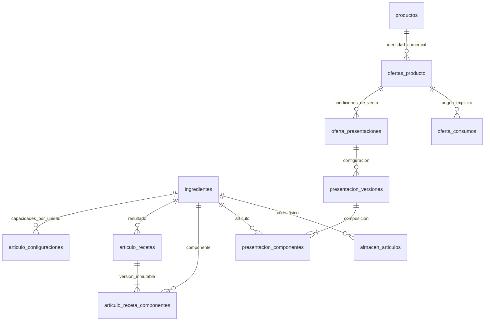
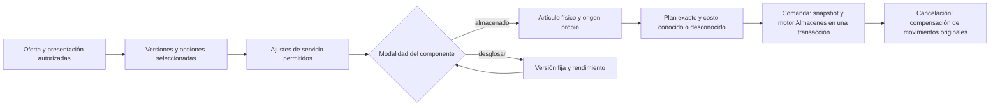

# Arquitectura de Casa Pestalozzi

## Estado A4: menú independiente por negocio

A4 retira Productos de la casa como funcionalidad operativa. Global no administra
productos comerciales, ofertas, publicaciones, políticas, personalizaciones,
recetas oficiales ni presentaciones oficiales. Restaurante y Panadería gestionan
sus ofertas y datos comerciales desde su propio contexto, con autorización local.
Global conserva `productos` para Artículos y preparaciones, además de Inventario,
Usuarios, Transferencias y las funciones transversales habilitadas.

`oferta_datos_comerciales` es la fuente de nombre, descripción e imagen de cada
oferta; `productos_oferta` conserva su interfaz compatible de lectura desde esa
fuente. Las ofertas mantienen precio, disponibilidad, categoría, área y orden.
La asociación comercial cruzada no se ofrece como operación nueva. No se crean
recetas automáticamente al registrar una oferta.

Recetas, versiones de presentaciones, variantes, ajustes, referencias de artículos,
almacenes y snapshots existentes permanecen intactos. Las recetas derivadas de un
estándar son recetas locales versionadas y continúan utilizándose en ventas; una
edición crea una nueva versión local. Las presentaciones heredadas usan su
configuración local válida y no consultan `presentacion_estandares` durante una
venta. Las tablas y triggers de publicación permanecen como historia, sin
autoridad sobre las operaciones vigentes. A4 no elimina datos ni aplica cambios a
la base operativa.

**Contexto histórico: cierre 3E, previo a A4 · 25 de octubre de 2026**

M0 integra segundo factor administrativo por privilegios efectivos (superadmin
y permisos directos de panel), JWT HS256 para integraciones entrantes y corte
de caja por turnos de Restaurante. M1 añadió administración local de Menú en los
negocios y M1.2 añadió temporalmente Productos de la casa; A4 retiró la parte
comercial Global, como establece el estado rector al inicio de este documento.
Los contratos detallados se desarrollan en [credenciales](usuarios/credenciales.md),
[API](../API.md#9-jwt-de-integraciones) y [operación](operacion.md#corte-de-caja-por-turnos).
Las rutas públicas `/panaderia`, `/panaderia/carta`, `/panaderia/pedidos`,
`/panaderia/nosotros` y `/panaderia/contacto` son un andamio de navegación
sin tienda, pedidos ni ventas funcionales. Sus APIs comerciales siguen bloqueadas.

Este documento es la única fuente normativa para alcance, arquitectura, propiedad, seguridad, datos y reglas de desarrollo. Describe la implementación de esta revisión: una entidad o pantalla existente por sí sola no significa que un módulo esté funcional. Las guías enlazadas explican procedimientos y detalles técnicos subordinados; si una referencia contradice estas decisiones, debe actualizarse antes de ampliar el módulo.

## 1. Objetivo y alcance

Casa Pestalozzi es una aplicación web PHP 8 MVC con MySQL. Una identidad compartida puede trabajar en tres ámbitos: Global, Restaurante y Panadería. Global es administrativo y no vende. Restaurante y Panadería son negocios distintos con oferta, almacenes, operaciones comerciales y finanzas propias.

El cierre 3E dejó funcionales Usuarios y Almacenes en los tres ámbitos y conservó
la operación comercial de Restaurante. M1 completó Menú de Panadería y la
administración de identidades comerciales de Global, retirada posteriormente por
A4. POS, tickets, pagos y finanzas de Panadería siguen pendientes; también los
paneles consolidados de Global. La tabla, ruta, contrato preparado o elemento de
menú de un módulo pendiente no se presenta como flujo liberado.

## 2. Arquitectura de aplicación

El flujo principal es `HTTP → Router / Auth → Controller → Service → Model → MySQL`; el Controller prepara una View HTML o una respuesta JSON. PHP MVC es propio, sin framework ni ORM. `public/index.php` registra rutas exactas; `Router.php` despacha. Composer registra `Controllers\\`, `Model\\`, `Classes\\`, `MVC\\` y `Services\\`.

- **Controller:** aplica controles HTTP, CSRF y validación estructural; coordina un caso de uso. No contiene reglas de negocio ni consultas complejas.
- **Service:** es la autoridad de casos de uso, reglas, autorizaciones de recurso y transacciones. Puede coordinar servicios de otros dominios mediante una frontera definida.
- **Model:** persiste y representa datos. No depende de Controllers, Views ni Services.
- **View:** presenta datos preparados; no consulta base de datos, Models ni Services.
- **Presenter/Serializer:** proyecta hechos ya resueltos; no vuelve a calcular reglas de negocio.
- **Integrations:** adaptan servicios externos; no son fuente de reglas ni de identidad.

Usar consultas preparadas y listas permitidas para identificadores SQL dinámicos. No introducir reescritura SQL, doble escritura de stock ni compatibilidad nueva con estructuras históricas descartadas.

## 3. Ámbitos, propiedad y estado de módulos

`unidades.slug` es la identidad estable del ámbito. No se infiere propiedad con un ID numérico, nombre enviado por el navegador ni selector visual. La sesión selecciona contexto, pero el servidor vuelve a cargar membresías, estado y permisos en cada petición y valida también detalles, listados, filtros, exportaciones, PDFs e integraciones.

| Módulo | Global | Restaurante | Panadería |
|---|---|---|---|
| Usuarios | Funcional: administra ámbitos delegados y privilegios dentro del techo autorizado | Funcional: administración local | Funcional: administración local con UI compartida |
| Almacenes e inventario | Funcional: maestro, almacenes propios, asignación, lectura consolidada y operaciones autorizadas en sus físicos | Funcional: almacenes propios, artículos, entradas, ajustes, mermas, movimientos, negativos y alertas | Funcional: mismas operaciones locales, aisladas por propietario |
| Catálogo maestro | Funcional para administrar artículos organizacionales | Consulta/uso autorizado en recetas e inventario | Consulta/uso autorizado en recetas e inventario |
| Menú y ofertas | Sin módulo comercial; consulta PDF solo con permisos del dueño | Menú, ofertas y escritura comercial local | Menú, ofertas y escritura comercial local |
| Recetas y variantes | Preparaciones de artículos compartidos; sin ofertas comerciales | Recetas operativas versionadas y variantes locales | Recetas operativas versionadas y variantes locales; POS pendiente |
| Reservaciones, mesas y KDS | No aplica | Flujos existentes funcionales | No implementados |
| POS, tickets y pagos | No vende; consolidación operativa pendiente | Flujos existentes funcionales | Modelo preparado; POS sin mesas pendiente |
| Finanzas y analítica | Finanzas y Análisis: comparativos de sólo lectura de los dos negocios (Finanzas: hoy, periodo y total; Análisis: ventas, tickets, indicadores y productos más vendidos por negocio), sin ventas ni gastos propios | Flujos existentes conservados; validar límites en su guía | Finanzas y Análisis funcionales con métricas de caja (mapa de calor de venta en lugar de RevPASH); las ventas contestan en cero hasta que exista la caja |
| Asistente IA | Funcional: consultas preensambladas del consolidado de almacenes y transferencias; sin ventas | Funcional: consultas preensambladas de ventas, equipo e inventario | Funcional: consultas preensambladas de ventas en caja, almacenes y menú; las de ventas contestan en cero hasta que exista la caja |
| Transferencias | Motor y UI compartidos M0.5-B; operación física propia | Motor y UI compartidos M0.5-B; operación física propia | Motor y UI compartidos M0.5-B; operación física propia |
| Producción y catering | Pendientes/fuera de 3E | Pendientes/fuera de 3E | Pendientes/fuera de 3E |

**Funcional** significa flujo respaldado por persistencia, autorización del servidor, interfaz o API real y pruebas de aceptación. **Preparado** significa que existen entidades o servicios parciales sin recorrido completo. **Pendiente** significa que el flujo no debe inferirse ni activarse por una ruta, tabla o fixture.

Global puede leer y consolidar datos según sus permisos; una vista consolidada nunca habilita escritura sobre un almacén, ticket o cuenta ajena. Restaurante y Panadería no comparten existencias comerciales por pertenecer a la misma organización.

## 4. Autenticación, autorización y Usuarios

La identidad es única y las membresías de `usuario_unidades` pueden combinar los tres ámbitos. Los permisos efectivos se guardan directamente en `usuario_unidad_permisos` por usuario, unidad y módulo; las facultades explícitas habilitan operaciones organizacionales concretas. No hay plantillas de permisos y un rol interno es metadato: no otorga acceso por sí solo.

En panel se usan `ver` y `editar`; `editar` incluye lectura. `operar` se limita a superficies de operación autorizadas, como POS, KDS y mapa de reservaciones. Si una identidad tiene acceso a cualquier panel administrativo en cualquier ámbito, exige contraseña. PIN/NIP se admite exclusivamente para el acceso de piso autorizado; una sesión de NIP no se convierte en sesión administrativa al cambiar el contexto o los permisos.

El servicio de Usuarios limita administración al ámbito delegado, aplica techos por módulo y facultad, valida el estado de cuenta y evita modificar el superadministrador o escalar privilegios desde campos del cliente. Revocar membresía o permiso afecta la siguiente petición protegida. La interfaz compartida no concede autorización. La gestión administrativa exige permiso de módulo y `usuarios.gestionar`; delegar permisos exige además `permisos.delegar`. No se implementan plantillas.

`usuarios.es_superadmin` es una excepción organizacional protegida. El CRUD ordinario no puede promover una cuenta. Las rutas privadas se clasifican expresamente; una ruta desconocida deniega en vez de quedar pública por omisión. Integraciones públicas conservan token o secreto propio. Mantener CSRF, limitación de intentos, HMAC para NIP, hashes seguros, no-store de credenciales efímeras y protección del último superadministrador activo.

La guía técnica está en [Usuarios](usuarios/usuarios.md), [permisos directos](usuarios/roles-y-permisos.md) y [credenciales](usuarios/credenciales.md); esta sección define el comportamiento que esas referencias deben respetar.

## 5. Almacenes e inventario

`ingredientes` es el catálogo maestro de artículos inventariables, distinto de `productos` comerciales. Un almacén es físico, tiene un único propietario (`unidad_id`), estado y política de negativos. Solo Global con facultad `almacenes.crear` crea almacenes y asigna su propietario a Global, Restaurante o Panadería. `catalogo.editar` controla la administración del catálogo maestro. Cada negocio opera solo almacenes propios y autorizados.

`almacen_articulos` es la única fuente de saldo por almacén/artículo. No existe saldo maestro duplicado ni almacén virtual para consolidación. El saldo consolidado se consulta por artículo compatible y se desglosa por negocio y almacén; cantidades de unidades incompatibles no se suman. Mínimo, estado y versión pertenecen a la asociación física. Los negativos se controlan por almacén.

`Almacenes` contiene el motor compartido; `AdministracionAlmacenes` coordina la interfaz, sin duplicar reglas ni saldos. Una operación registra la petición/idempotencia, movimientos inmutables, saldo y documento relacionado de forma atómica. Bloqueos ordenados/versiones evitan carreras y sobreescritura perdida. Entradas, ajustes, conteos, mermas, consumos y compensaciones deben ser trazables. No reportar éxito antes del commit coordinador. Identificadores manipulados nunca permiten consultar ni modificar existencias ajenas.

Global consulta el inventario consolidado y opera únicamente sus propios almacenes. Restaurante y Panadería asocian artículos, registran entradas, ajustes y mermas, consultan movimientos, alertas y totales, y configuran negativos si tienen permiso. Transferencias incorpora solicitud, autorización, envío, recepción parcial, incidencias y retornos con contexto propietario; véase su [contrato](modulos/transferencias.md). Producción y variantes avanzadas siguen pendientes. Referencia de pantalla: [Almacenes](modulos/almacenes.md).

## 6. Catálogo, productos, cartas, ofertas y menú preservado

`productos` contiene identidad descriptiva que puede compartirse. `ofertas_producto` representa una decisión comercial propia del negocio: precio, categoría, disponibilidad, orden y área de producción. Cartas, categorías, áreas, ofertas, recetas y variantes se validan en el ámbito correcto. No fusionar productos solo por nombre ni clonar una oferta de Restaurante en Panadería sin una decisión comercial explícita.

Las recetas/versiones, subrecetas y variantes pertenecen a la oferta. Los ajustes de variante identifican componentes concretos. Consultar una receta no permite acceder al inventario de otra unidad. Las ventas y el consumo resuelven el origen de stock del negocio vendedor sin fallback a otros almacenes. Ese origen (`oferta_consumos`) se elige a mano en la receta, con `productos/editar`, para cada artículo que la receta activa, sus subrecetas o las variantes que agregan o sustituyen pueden descontar, entre almacenes activos del negocio donde el artículo está asociado. Sin él, la comanda se rechaza completa.

El DML preserva el menú original de Restaurante: 112 productos y sus 112 ofertas, IDs y relaciones, 15 categorías, 3 cartas, 4 áreas de producción y disponibilidad/orden/precios/descripciones originales. Las 13 imágenes propias están versionadas y se sirven desde los assets de aplicación; el fallback de categoría continúa disponible. Los productos y ofertas sintéticos (IDs desde 1000, sin prefijos visibles) son adiciones independientes para escenarios de prueba y no alteran esos 112 registros. Panadería usa una oferta sintética propia en desarrollo, no una copia del menú real.

## 7. Tickets, operación y consumo

Todo ticket pertenece a una unidad vendedora. Global nunca es vendedor. Restaurante conserva mesas, mapa, reservas, toma y envío de comandas, KDS, impresión, entrega, cobro y cancelación. Los snapshots guardan oferta, negocio, nombres, precio, categoría, área, variante, receta/costo conocido y cantidad; el cliente no determina el precio ni resuelve el producto por nombre.

La comanda usa una clave idempotente y el consumo se realiza al enviarla, no al abrir una mesa, preparar un carrito ni reintentar el cobro. El consumo y el documento de ticket se confirman en una transacción; errores parciales no dejan escritura huérfana. Una cancelación compensa los movimientos originales una sola vez, con almacén/costo congelados, sin recalcular la receta vigente. Una receta inventariable sin origen completo falla sin mutación parcial. Una venta sin consumo permitido queda explícita en su snapshot y no inventa costo conocido.

El POS futuro de Panadería sin mesas es una extensión preparada, no está habilitado por el esquema ni por fixtures. La [guía de operación](operacion.md) detalla impresión e idempotencia; la [guía de reservaciones](reservaciones/reservaciones.md) describe el mapa y sus estados.

## 8. Pagos, finanzas y analítica

Tickets y pagos pertenecen al negocio vendedor. Las finanzas registran egresos y hechos financieros no derivados de tickets según su contrato. Un informe no vuelve a sumar como ingreso una venta que ya calcula desde partidas/pagos del ticket. Las cuentas divididas cuadran con partidas entregadas; propina conserva su tratamiento explícito. Cancelaciones netean ventas y devoluciones futuras requieren un contrato propio.

Las vistas e informes locales filtran tanto la raíz como sus relaciones. Los consolidados futuros agregarán sin multiplicar filas y sin tratar una transferencia entre negocios como venta o gasto. Costos históricos conocidos permanecen congelados; los desconocidos se muestran como desconocidos, no se sustituyen con el costo actual de una receta. Consumo neto y merma se separan.

Restaurante conserva las consultas analíticas existentes. Los datos versionados incluyen 365 tickets analíticos con 803 líneas, además de una semana RevPASH de 26 tickets en las 11 mesas reservables y 44 asientos, sin solapamientos; también incluyen ventas locales del Asistente en 90–91 fechas observadas. El asistente actual ofrece 12 intenciones estructuradas: ventas por total/producto/categoría, top, ticket promedio, sin venta, meseros, horas pico, cancelaciones, stock, consumo y bajo stock. No calcula rentabilidad/costo, mesas, coocurrencias o finanzas como consulta del asistente, y no usa un proveedor LLM. Panadería y Global tienen su propio catálogo con el mismo motor (`ConsultasRapidasAmbito`, ver [configuración](config.md#panaderia-y-global)): Panadería pregunta por sus ventas en caja, almacenes y menú; Global lee el consolidado de almacenes con la regla de lectura de Almacenes y las transferencias, sin sumar ventas desde el Asistente. El comparativo de ventas y finanzas Global está disponible en sus módulos de sólo lectura.

Finanzas comparte una sola fuente de cifras por negocio (`Services\Finance\FinanzasNegocio`) entre Restaurante, Panadería y el consolidado de Global, que suma sólo ventas y costos de los negocios, incluye el inventario de Global y saca los márgenes de los totales ([Finanzas](modulos/finanzas.md)).

## 9. DDL, DML, fixtures e instalación

El procedimiento soportado para instalar es: `database/ddl.sql` → `database/deploy.sql` → `database/menu-restaurante.sql` → `database/development.sql` (solo development/test; el instalador habilita un guard de sesión para el hash de `admin_demo`) → bootstrap CLI que valida el secreto local y marca la cuenta → compilación de assets. Lo ejecuta `scripts/desarrollo/instalar.php` y se explica en [instalación](desarrollo/instalacion.md). Los tests también verifican la importación SQL directa sobre una base temporal de development/test sin el marcador del instalador; en ese caso el DML de desarrollo activa la cuenta conocida. Nunca usar ese flujo directo fuera de una prueba controlada o una base local nueva. No se importa la base antigua, un respaldo privado ni scripts externos.

`deploy.sql` contiene datos estructurales y no crea credenciales conocidas. `menu-restaurante.sql` es la fuente canónica del catálogo preservado; `database/menu-integridad.json` verifica correspondencias/hashes y no es un catálogo paralelo. `development.sql` agrega fixtures sintéticas una sola vez y rechaza una segunda carga mediante sus claves/marcador. No es un seed de producción.

Los fixtures actuales incluyen unidades/usuarios de referencia, almacenes y artículos compartidos, ledger de aperturas, operación de Restaurante, recetas/subrecetas/variantes, reservas con estados, superficies/mesas, KDS, ventas históricas durante 12 meses, pagos divididos, cancelaciones, gastos, feedback, catas, horarios y anuncios sintéticos. Hay una oferta de Panadería de prueba, con existencias independientes. No copiar INSERTs del esquema mononegocio retirado, no almacenar `ingredientes.stock`, no alterar las 112 ofertas preservadas y no insertar saldos que no correspondan a movimientos.

`admin_demo` solo se incorpora mediante el DML de desarrollo. En el procedimiento CLI, el instalador establece el guard para `development`/`test` y el bootstrap exige `DEV_SUPERADMIN_PASSWORD` local que verifique el hash y registra la identidad en la marca de instalación; una cuenta homónima ajena no se promueve. En una importación SQL directa, el DML activa la cuenta únicamente cuando no existe el marcador del instalador; por ello esa forma se reserva a pruebas controladas sobre bases locales nuevas. `development.sql` contiene el hash bcrypt, nunca el texto claro. `deploy.sql` no crea la cuenta, no hay ruta pública y el instalador/bootstrap no se ejecutan en producción. Mantener `includes/.env` privado y fuera de Git.

El instalador exige base inexistente y conserva evidencia del destino/propiedad. No ejecutar DROP ni reconstruir una base ambigua. Dos ensayos limpios deben usar nombres independientes; mantener respaldo y posibilidad de recuperación del entorno local.

## 10. Interfaz y diseño

Global y Panadería parten de los layouts, sidebar, topbar, encabezados, tablas, filtros, formularios, botones, modales, alertas, iconos y estilos responsive de Restaurante. Preferir componentes parametrizados por ámbito/permisos/acciones frente a interfaces completas duplicadas. Conservar el selector de contexto debajo del logotipo y la identificación visible del ámbito activo. El servidor vuelve a autorizar cada acción; ocultar un botón no es seguridad.

No rediseñar Restaurante en el cierre. Editar fuentes de `src/` y compilar con Gulp; no editar bundles generados a mano. La interfaz de Almacenes debe desglosar unidades/almacenes en tablas; no se exigen gráficas avanzadas. Los formularios de Usuarios reflejan los techos de delegación y el mismo servicio compartido.

## 11. Organización de Services y responsabilidades

Las clases se alojan en un nivel por dominio bajo `services/<Dominio>/Clase.php` y declaran `Services\\<Dominio>`. No añadir Services directamente en la raíz ni inventar subcapas para evitar clasificar la responsabilidad.

| Dominio | Responsabilidad principal |
|---|---|
| `Analytics` | Analíticas y recomendaciones autorizadas |
| `Development` | Instalación y bootstrap CLI identificados de desarrollo/pruebas |
| `Configuration` | Configuración de la aplicación |
| `Contact` | Contacto y comunicación |
| `Integrations` | Adaptadores externos |
| `Inventory` | Almacenes, existencias, recetas y su motor compartido |
| `Menu` | Catálogo, cartas y ofertas |
| `Notifications` | Preparación y orquestación de comunicaciones |
| `Pos` | Casos de uso de venta e impresión |
| `Reservations` | Reglas y operaciones del agregado de reservaciones |
| `Scheduling` | Calendarios, horarios y afectaciones de agenda |
| `Security` | Tokens, sesiones y autorización |
| `Shared` | Coordinación realmente transversal, como locks compartidos |
| `Tables` | Hechos y proyecciones comunes de mesas |
| `Users` | Identidad, membresías y administración de Usuarios |

`Shared` es una excepción para componentes usados por varios dominios, no un cajón. La carpeta sigue la responsabilidad principal, no el nombre de la clase. `Notifications` prepara y coordina las comunicaciones; `Security` administra tokens, sesiones y accesos; `Scheduling` resuelve horarios y registra afectaciones; `Reservations` conserva las reglas de su agregado. Que una clase incluya `Reservation` en su nombre no significa que pertenezca a `Reservations/`. `HorarioReservacionService` permanece en `Reservations` porque valida fechas, anticipación y último horario reservable; `HorarioOperacionImpactoService` pertenece a `Scheduling` porque evalúa y persiste afectaciones de agenda. Las colaboraciones existentes entre agenda, reservas y notificaciones son explícitas; no alterarlas como refactor incidental.

## 12. Pruebas y aceptación

Para una modificación multinegocio, probar permisos de servidor y niveles, contexto, estado de cuenta, delegación/revocación, IDs ajenos y datos cruzados. Para stock, probar balances contra ledger, negativos, precisión, idempotencia, concurrencia y rollback sin escritura parcial. Para comercio, verificar unidad vendedora, snapshots, menú original, consumo/compensación, estados KDS, pagos y ausencia de doble conteo.

La puerta de regresión se define en [pruebas](desarrollo/pruebas.md): preservación del menú, esquema 3A, permisos 3B, Almacenes 3C, comercio/Restaurante 3D, Usuarios/Almacenes 3E, suites PHP/JS, DML, dos instalaciones independientes, HTTP y recorrido real de navegador en contextos/responsive. Un `200` o una tabla no bastan para afirmar funcionalidad. Informar resultados y limitaciones: los ensayos simulados no certifican impresoras, hardware, SMTP, WhatsApp/Meta, credenciales de proveedor ni n8n externo.

## 13. Reglas para agentes y cambios futuros

Antes de trabajar, leer este documento y `CLAUDE.md`, identificar ámbito/propiedad, revisar servicios, consumidores, DDL/DML y UI equivalente de Restaurante. Documentar estado real, permisos, facultades, transacciones, límites y pruebas antes de ampliar un servicio compartido. Mantener DDL, despliegue, fixtures y consumidores sincronizados. Añadir pruebas de aislamiento y actualizar guías. No retirar pruebas funcionales para acomodar una implementación incompatible ni presentar una maqueta como flujo acabado.

Toda función nueva se integra con identidad, autorización, propiedad y visuales existentes. No crear autenticación, stock, oferta, tickets o UI paralelos. Cambios arquitectónicos requieren decisión justificada aquí y actualización de referencias técnicas. Separar correcciones de defectos, mejoras de lo existente y funcionalidades nuevas en el [backlog](backlog.md). Un defecto crítico no se difiere como UX.

El [contrato de transferencias M0.5-B](modulos/transferencias.md) implementa solicitud, autorización, envío, recepción total/parcial, diferencias, rechazo y retorno: tránsito no es saldo disponible del destino ni ingreso/gasto. Una pérdida sin retorno ni recepción permanece como incidencia trazable; no se inventa una compensación. Producción, catering, POS comercial de Panadería, paneles financieros Global y devoluciones comerciales posteriores siguen fuera de 3E hasta que se implementen y prueben expresamente.

## 14. Documentación vigente

- Este archivo: contrato rector y única fuente de decisiones de arquitectura/alcance.
- [Instalación](desarrollo/instalacion.md), [desarrollo](desarrollo/desarrollo.md), [pruebas](desarrollo/pruebas.md), [backlog](backlog.md), [índice documental](desarrollo/clasificacion-documental.md) y [guía técnica de interfaz](desarrollo/interfaz.md).
- Referencias funcionales subordinadas: [Usuarios](usuarios/usuarios.md), [permisos](usuarios/roles-y-permisos.md), [Almacenes](modulos/almacenes.md), [reservaciones](reservaciones/reservaciones.md), [notificaciones](reservaciones/notificaciones.md), [operación](operacion.md), [privacidad](privacidad/privacidad.md), [configuración](config.md) y [API](../API.md).
- Referencia técnica de organización de código: §§2 y 11 de este documento y los contratos del código. Los documentos históricos de etapas anteriores no son procedimientos vigentes.

## 10. Administración comercial M1 y retirada A4

M1 introdujo administración de menú multinegocio y M1.2 añadió Productos de la
casa. A4 retiró ese flujo Global y sus políticas: esos contratos y resultados
pertenecen a la historia de Git, no a la autorización vigente. Restaurante y
Panadería conservan administración local de ofertas. Global puede leer PDFs de un
negocio únicamente si el usuario tiene permiso de Menú en Global y el permiso
requerido para el negocio dueño; la lectura no permite escribir sobre la oferta.

El estado vigente de propiedad, preservación y pruebas está en [Menú comercial
local después de A4](modulos/catalogo-comercial.md) y en [Pruebas A4](desarrollo/pruebas.md#cierre-a4).

## 15. M2: arquitectura unificada de artículos

Base aprobada disponible localmente: `baf089b` (`main` y `origin/main`), integración
M1.2. Trabajo en `codex/m2-articulos-recetas-unificados`, worktree propio bajo
`tmp/m2-articulos-recetas-unificados`. No se alteran otros worktrees. El checkout
original conserva su modificación de AdminMenuController. La base tiene un import
duplicado de ContextoNegocio que impide compilar ese controlador; se corrige antes
de validar M2. No se hace push, merge ni DDL sobre la base configurada.

### Auditoría y matriz de compatibilidad

| Estructura / consumidores | Autoridad actual | Evolución acordada |
|---|---|---|
| ingredientes; Ingrediente, Almacenes, ConsultasAlmacen, proveedores | Identidad operativa, unidad, estado y costo referencial | Reutilizar IDs y FK como catálogo maestro de artículos; el nombre físico es compatibilidad, no un segundo catálogo |
| almacen_articulos; operaciones/movimientos_inventario; Transferencias | Único saldo por almacén/artículo, ledger y costo congelado | Sin reconstrucción, copias ni nuevas existencias al configurar recetas |
| productos, ofertas_producto, productos_oferta; Ofertas | Identidad técnica histórica, oferta por negocio y lectura comercial compatible | Preservar IDs y referencias; el negocio escribe sus datos locales y no se crean asociaciones cruzadas nuevas |
| oferta_datos_comerciales | Nombre, descripción e imagen independientes por oferta | Fuente de escritura comercial y de la vista compatible `productos_oferta` desde A3 |
| producto_estandares, producto_publicaciones, oferta_personalizaciones | Historia de M1.2 | Preservar tablas y datos; sin dependencias operativas desde A4 |
| recetas, receta_componentes; RecetasOferta | Versiones por oferta y FK de ticket_items | Mantener como referencias históricas y adaptador de entrada; el resolvedor de artículos es compartido |
| subrecetas, subreceta_ingredientes; Subreceta | Preparaciones privadas, desglose de un nivel | Asociación explícita a identidad operativa; nueva elaboración mediante versiones de artículos, sin deducir identidad por nombre |
| recetas_casa, receta_casa_versiones/componentes, receta_origen_casa | Estándares comerciales históricos | Preservar tablas, vínculos y triggers; las recetas operativas materializadas siguen siendo locales y versionables |
| producto_variantes, variante_ajustes; Variantes, editor JS, POS | Grupos, selección, precio, DTO ingrediente/subreceta | Reutilizar opciones/IDs; adaptar componentes a artículos. Separar permisos de precio y composición; ajustes de servicio no reescriben producción |
| oferta_consumos; AlmacenesConsumo, ConsumoOferta | Almacén explícito por oferta/artículo y negocio | Reutilizar los mismos orígenes físicos al resolver presentaciones; sin fallback |
| Comercial, ticket_items, KDS, impresión, HistorialTickets | Snapshot comercial, receta, variantes y costo | Congelar resolución ejecutada; movimiento y snapshot en la transacción actual; compensar ledger original |
| Finance/DiagnosticoFinanciero, Analytics, Inventario, PDF | Hechos históricos y proyección comercial | No recalcular históricos con recetas nuevas; presentación conserva identidad comercial y precio autorizado |
| AdminMenu/AdminRecetas/AdminAlmacenes; views/admin y rutas public/index.php | Formularios y navegación vigentes | Mantener operaciones locales de menú y artículos; no crear catálogo o escritor comercial Global |
| scripts/tests/run-{menu,recetas-casa,estandares,almacenes,restaurante}*, suites PHP/JS | Contratos de regresión | Preservar aserciones, añadir bases desechables y casos M2; separar fallos previos documentados |

### Modelo y reglas de composición

`ingredientes` sigue siendo la identidad operativa única. Las capacidades pertenecen
a una configuración por unidad y se combinan (comprar, componer, elaborar,
almacenar); no hay discriminador de tipo. Nombre/unidad pertenecen al maestro;
capacidad y receta propia al negocio; precio/categoría al comercio; saldo al
almacén. Compartir identidad no comparte receta privada, permisos ni existencias.

Las recetas de artículo tienen resultado, propietario, versión, rendimiento/unidad,
procedencia, actor y estado. Cada componente referencia un artículo y, cuando se
desglosa, una versión concreta de su elaboración. Una versión publicada no se
actualiza ni elimina; una modificación crea otra. Las referencias a versiones
previas se conservan incluso al publicar una nueva. Publicar no produce stock.

Las presentaciones dependen de una oferta. Su versión describe uno o varios
artículos operativos y la modalidad explícita de cada uno: `almacenado` detiene el
desglose, `desglosar` exige receta fijada. La etapa distingue elaboración y servicio.
Botella sellada y vino abierto son artículos distintos relacionados por una receta
de transformación prevista; vender una copa no abre una botella automáticamente.
Rol de canela almacenado consume piezas, y croissant con crema consume pieza más
complemento. M2.5 registrará producción, lotes y valorización; M3 habilitará POS
Panadería. M2 no habilita ninguno de esos motores.

### Resolución, variantes y costos

El resolvedor prepara datos sin movimientos: negocio, oferta/presentación, versión,
opciones y ajustes, cantidades/unidades, etapa, ruta de versiones y orígenes. Valida
actividad, pertenencia local o Global, dimensiones, rendimiento positivo, ciclos
por artículo (también indirectos), profundidad máxima y presupuesto de componentes.
Usa decimales exactos y convierte únicamente g/kg y ml/l; piezas no se convierten
a masa/volumen. Rechaza un resultado menor que la precisión física admitida.

Una variante comercial sin ajustes no requiere autorización de receta. Un delta
requiere política comercial; un cambio de composición requiere política de receta.
No se permite quitar o sustituir ingredientes internos de un artículo almacenado.
La sustitución de una preparación se aplica al componente visible antes del desglose.
Los complementos se agregan en servicio. Las opciones siguen validándose en servidor.

Costo referencial y costo físico se conservan separados: desconocido se representa
con null, nunca cero implícito. Para producción futura el contrato será entradas
consumidas con costos congelados / rendimiento real, más costos explícitos; M2
solo resuelve esa previsión y no valoriza movimientos de transformación.

### Migración y retiro de adaptadores

1. Respaldo consistente externo y verificación de restauración antes del despliegue.
2. DDL aditivo reproducible; no renombrar ni borrar tablas/FK históricas.
3. Asociar identidades únicamente mediante IDs de origen y correspondencia única.
   Una coincidencia de nombre nunca basta; asociaciones ambiguas quedan pendientes.
4. Mantener los 112 productos, imágenes, precios/categorías/cartas, publicaciones,
   tickets, snapshots, membresías y el ledger sin UPDATE de normalización histórica.
5. Nuevos flujos escriben versiones de artículos/presentaciones. Los lectores
   existentes entran mediante adaptadores al mismo contrato de resolución.
6. Un adaptador legado solo puede retirarse cuando no quedan escritores ni ventas
   nuevas dependientes, todas las referencias tienen correspondencia verificada y
   las suites M1.2/POS/Almacenes pasan. Las tablas históricas no se eliminan.
7. Validar instalación nueva y actualización repetida en bases temporales distintas;
   comparar hashes/conteos y saldo contra ledger antes/después. DDL MySQL no es
   transaccional: recuperación es restaurar respaldo en otro destino verificado,
   nunca ejecutar un down que pierda versiones o movimientos.

Este contrato se implementa mediante `Articulos`, `ResolucionArticulos` y
`PresentacionesOferta`. El cierre, las pruebas y las limitaciones verificadas se
registran en [Pruebas](desarrollo/pruebas.md#cierre-m2).

### Persistencia final y transición M2

El único maestro operativo continúa físicamente en `ingredientes`: sus claves son
las de Almacenes y proveedores. `articulo_configuraciones` añade capacidades por
unidad, incluida `produccion_previa`, sin poblarlas por deducción. La capacidad de
elaborar no selecciona automáticamente una receta ni un modo de consumo.
`articulo_recetas` y sus componentes contienen las versiones cerradas; la FK de
cada componente apunta a una versión concreta local o Global. Global no puede
referenciar una receta privada. Los triggers impiden mutar versiones publicadas.

`oferta_presentaciones` conserva la unicidad comercial producto/negocio;
`presentacion_versiones/componentes` permiten botella, copa o montajes mixtos.
`presentacion_estandares` y su configuración permanecen como historia de
publicaciones anteriores. Los flujos vigentes leen la versión local válida de la
presentación y no consultan esa tabla para autorizar ventas. Precio y composición
se editan con permisos locales; no existen publicación oficial ni políticas
comerciales Global.

`articulo_correspondencias` enlaza preparaciones antiguas mediante selección
manual de IDs; congela su edición anterior. `receta_componentes_articulos` y
`receta_casa_composiciones` fijan versiones nativas en contratos anteriores.
Las preparaciones aún pendientes se adaptan en memoria al resolvedor único;
no se generan saldos ni otro catálogo. El alta de nuevas preparaciones conduce al
catálogo común. No se borran recetas antiguas referenciadas por tickets.

`ticket_item_resoluciones` conserva composición ejecutada, variantes, etapas y
huella semántica SHA256. `articulo_comandos` registra idempotencia por unidad.
La comanda registra snapshot y movimientos en la misma transacción; el reintento
lee ese hecho y la cancelación compensa el ledger original una sola vez. Las
cantidades nativas se exigen exactas a milésimas; la frontera heredada conserva
su redondeo half-up para no cambiar ventas existentes. Los costos son decimales o
`null`; la valorización física sigue perteneciendo al motor de Almacenes.
