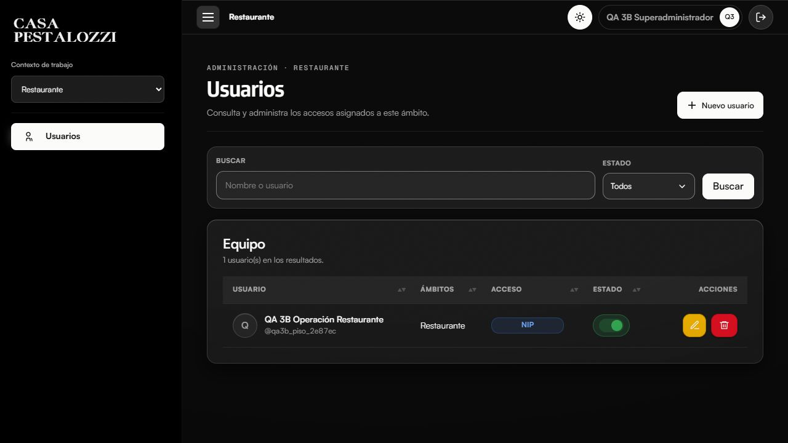
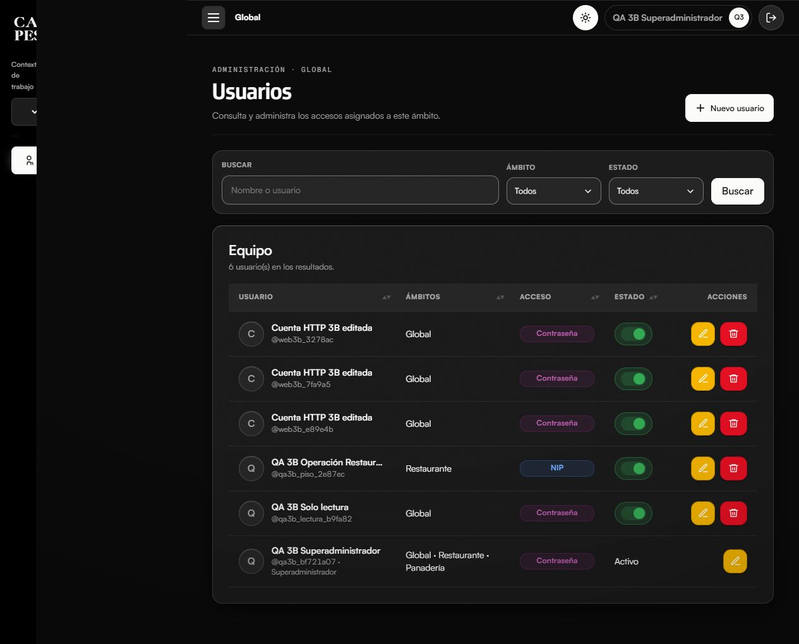
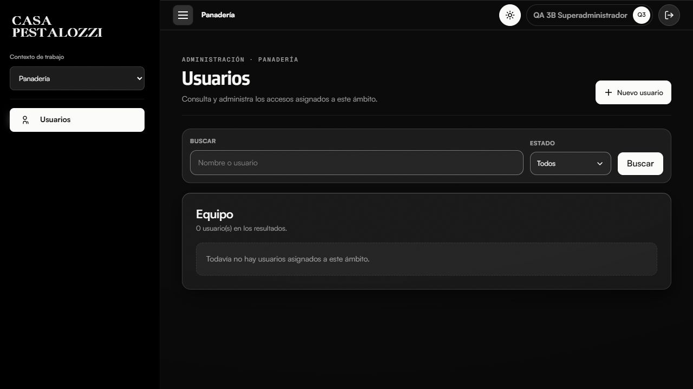
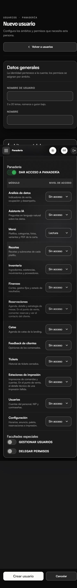

# Etapa 3B.2 — Usuarios y permisos por ámbito

Rama `codex/usuarios-permisos-multinegocio-3b`, desde `73de92d` de 3A.
Primer commit: `3eeb390` (núcleo). El segundo commit contiene esta entrega.
No se modifica main, no se hace push/merge y package-lock.json ajeno queda fuera.
La configuración del sitio y su base original no se reconstruyen ni migran.

## Modelo y autenticación

Rige el [contrato de autorización](contrato-autorizacion-3b.md).
Membresías usuario/unidad y permisos directos usuario/unidad/módulo, con
ver/editar para panel y operar para pdv/area/reservations_map. Roles son
metadata nullable y no aportan permisos. Global no concede otros ámbitos.
La excepción organizacional explícita es usuarios.es_superadmin.

La unión de permisos activos decide contraseña o PIN; la sesión registra su
nivel de autenticación y se revalida en cada petición protegida. Cambiar una
cuenta operativa a panel exige contraseña nueva y volver a autenticarse.
Se conservan hashes y lookup HMAC. La caída de consultas deniega acceso;
una tabla de versiones existente sin marcador 3B no selecciona el esquema viejo.
El límite de intentos es compartido por IP/canal con bloqueo de archivo,
independiente de cookies; además se conserva el límite NIP por sesión.
El login 3B y las escrituras usan CSRF. Las contraseñas conservan sus espacios.

## Usuarios y delegación

UsuarioService extiende sus métodos con AccesosUsuario. Global puede crear
cuentas solo Global, solo Restaurante, solo Panadería o combinadas; el techo
por módulo/facultad se comprueba en servidor. Local solo administra su ámbito.
Una identidad compartida conserva credenciales, identidad, estado global y
membresías ajenas ante un gestor local; su baja local revoca la membresía.
La protección del último superadministrador usa transacción y bloqueos.
Se rechazan claves no admitidas, ámbitos ajenos y transacciones externas.

## Interfaz y rutas

Las tres rutas comparten el mismo controlador, listado y formulario:

- `/admin/usuarios`
- `/admin/global/usuarios`
- `/admin/panaderia/usuarios`

Se reutilizan layout, sidebar, topbar, users.css/menu.css, filtros, tablas,
botones, switches, alertas y modal administrativos de Restaurante. El selector
permanece debajo del logotipo y el encabezado identifica el contexto activo.
No existe selector de roles ni plantillas. Los niveles disponibles respetan
el techo delegado y el método de acceso se calcula con los ámbitos elegidos.
El NIP se entrega una vez con no-store y vencimiento del flash.

Capturas con fixtures sintéticos, tema del sistema y los mismos componentes:

Se comprobó el selector de contexto, estados vacíos, teclado (Tab de usuario a
nombre), aparición de contraseña al conceder panel y ocultamiento de ámbitos
desmarcados. En 390 px la matriz tiene dos columnas visibles y ancho de 307 px;
el documento no tiene desbordamiento horizontal. Revisión ux-ui independiente.

## Matriz de validación

| Comprobación | Evidencia |
|---|---|
| Ámbitos independientes, combinados y Global limitado | Runner DB 3B aislado |
| Ver/editar/operar; lectura sin escritura; recurso ajeno | Runner DB 3B y HTTP |
| Roles metadata sin privilegios implícitos | Runner DB 3B |
| PIN solo POS/KDS/mapa, unión panel/piso y promoción | Runner DB 3B |
| Revocación de permisos/membresía y cuenta inactiva | Runner DB 3B |
| CRUD Global/local, cuentas compartidas, techo y último super | Runner DB 3B |
| Credenciales preservadas, PIN↔panel y reautenticación | Runner DB 3B |
| Login, CSRF, contexto, formulario real, lectura y logout | Runner HTTP loopback |
| Resultado final DB 3B | 128 comprobaciones correctas; base temporal eliminada |
| Resultado final HTTP | 28 comprobaciones correctas contra servidor aislado |
| Intentos compartidos independientes de cookies | 56 comprobaciones correctas |
| Regresión relacional/menu 3A | 114 correctas; dos bases eliminadas; 112 productos, 15 categorías, 4 áreas, 13 imágenes |
| Suite PHP existente | Mismo fallo previo en run-reservaciones-cierre-static.php: estados de entrega compatibles con cocina |
| Suite JS existente | Correcta, incluidos 251 escenarios de notificaciones y contratos POS/mapa |

Los runners DB crean nombres aleatorios cp_multinegocio_test_* y verifican
una marca privada de propiedad antes del despliegue y la limpieza. El servidor
HTTP usa el mismo aislamiento, sesiones separadas, integraciones sintéticas,
solo loopback y no despacha PHP solicitado como archivo estático. No selecciona
la base configurada, tampoco para preparar fixtures.

## Auditoría

Revisión independiente de seguridad y revisión ux-ui exigida por CLAUDE.md.
Se corrigieron la selección insegura de un esquema 3A incompleto, el contador
NIP limitado a cookies, el flash sin vencimiento, la discrepancia de baja local,
el recorte de contraseñas y la visibilidad de campos de credenciales.
Las escrituras revalidan actor, facultades, techo y estado del destinatario
dentro de la transacción. No salen hashes ni PIN en listados o DTO.

## Límites y riesgos pendientes

Los restantes consumidores del esquema nuevo todavía no están adaptados.
POS, KDS, mapa, Menú, Tickets, Almacenes y Finanzas no se certifican operativos
en esta base: tras verificar permisos, responden 503 MODULO_PENDIENTE antes
de ejecutar consultas mononegocio. No se activa parcialmente el esquema.
La implementación anterior sigue seleccionada exclusivamente en la base
original sin tabla de versión. No hay suma de derechos entre ambos modelos.

El límite compartido de login funciona en un servidor con filesystem compartido
entre sus procesos; un despliegue con varios nodos requerirá un almacén común.
El límite actual es por IP/canal, no por cuenta: no detiene un ataque distribuido.
Sus archivos en temp requieren una política de caducidad/limpieza del entorno.
La auditoría final de código no encontró bloqueantes nuevos. ux-ui aprobó la
comparación de escritorio y la matriz móvil corregida en una confirmación final.
La excepción superadmin se crea solo en fixtures/instalación controlada y nunca
mediante datos enviados al CRUD. No se crean cuentas ni secretos reales.
No se inicia ninguna etapa de Almacenes u otros módulos.
