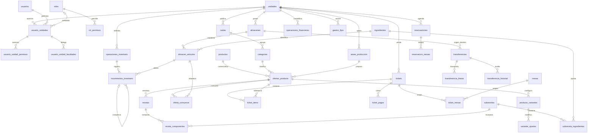

# Modelo relacional revisado — Etapa 3A

Versión de contrato SQL: `multinegocio-3a-v1`. Revisión central previa al DDL,
2026-10-24. Destino: MySQL 8.0.16+ / 9.x, InnoDB, utf8mb4. No activar sobre la
BD configurada: los consumidores actuales se adaptarán en 3B y siguientes.

## Relaciones y claves

Este diagrama resume raíces; cada FK compuesta indicada abajo incluye unidad.
No representa permisos de servidor ni implementa servicios operativos.

## Contrato físico central aprobado para implementación

- `unidades`: id TINYINT UNSIGNED; slug UNIQUE; tipo ENUM(global,negocio).
  UNIQUE(id,tipo). Global es propietario administrativo y nunca vendedor.
  Las raíces exclusivas de negocio (cartas, categorías, áreas, ofertas, recetas,
  subrecetas, mesas, reservas, tickets) llevan unidad_id y discriminador
  unidad_tipo fijo negocio, CHECK y FK (unidad_id,unidad_tipo) a unidades.
- IDs de usuarios/roles/tickets/mesas/reservas mantienen INT con signo para las
  referencias operativas; productos/categorías/artículos/recetas/variantes/ofertas
  usan INT UNSIGNED; áreas TINYINT UNSIGNED; operaciones/movimientos/transferencias
  usan BIGINT UNSIGNED. Cada FK debe coincidir exactamente con la clave padre.
- Raíces con hijos por ámbito tienen UNIQUE(id,unidad_id). La redundancia de
  unidad en hijos permite FK compuesta: no es otra fuente de propietario.
- `roles.unidad_id` nullable: NULL indica plantilla compartida/sistema, valor
  indica rol local. Membresía PK(usuario_id,unidad_id), FK rol_id nullable y
  sin permisos implícitos desde 3B. Triggers de
  integridad rechazan rol local ajeno y cambio de dueño con membresías incompatibles.
  `usuarios` conserva username/password_hash/nip_hash/nip_lookup/activo; se retiran
  rol y unidad únicos; agrega es_superadmin como excepción protegida.
  `rol_permisos` conserva metadata. `usuario_unidad_permisos` tiene PK triple,
  FK a membresía y ver/editar para panel u operar para piso Restaurante.
- `facultades` es catálogo de claves y solo_global; `usuario_unidad_facultades`
  PK(usuario_id,unidad_id,facultad), FK membresía y catálogo; rechaza facultades
  solo_global en negocios. Delegación, límites del actor y autorización van en 3B.
- `almacenes` dueño NOT NULL, permitir_negativos y activo; UNIQUE(id,unidad_id).
  `ingredientes` es catálogo compartido sin stock/stock_minimo: nombre, unidad,
  costo DECIMAL(10,4), activo. `almacen_articulos` PK(almacen_id,articulo_id),
  unidad_id, saldo DECIMAL(12,3), minimo DECIMAL(12,3), activo, version; FK almacén
  por dueño y UNIQUE(almacen_id,articulo_id,unidad_id). CHECK minimo>=0.
  Triggers impiden saldo negativo con configuración false y deshabilitar negativos
  con saldo ya negativo. No hay totales físicos duplicados.
- `cartas` PK(unidad_id,slug), nombre, orden, activo: comida/maridaje/temporada.
  `categorias` id UNSIGNED, unidad_id, nombre, carta, img nullable, activo, orden;
  FK(unidad_id,carta). `areas_produccion`: id TINYINT UNSIGNED, unidad_id,
  nombre, slug, color, orden; UNIQUE(unidad_id,slug). Deploy no siembra categorías
  ni áreas que colisionen con las importadas. Seed sí crea cartas por negocio.
- `productos`: id UNSIGNED, nombre, descripcion nullable, img nullable. Sin UNIQUE
  nombre, sin precio, estado, categoría o área duplicados. `ofertas_producto`:
  id UNSIGNED, producto_id, unidad_id, categoria_id UNSIGNED, precio DECIMAL(8,2),
  area_id TINYINT UNSIGNED, activo, orden. UNIQUE(producto_id,unidad_id),
  UNIQUE(id,unidad_id), UNIQUE(id,producto_id,unidad_id); FK categoría/área por
  unidad. Estado comercial solo en oferta. No tabla paralela menu/productos_semilla.
- `recetas`: id, oferta_id, unidad_id, version positiva, activo;
  UNIQUE(oferta_id,version), UNIQUE(id,unidad_id), UNIQUE(id,oferta_id,unidad_id).
  `receta_componentes`: receta_id/unidad_id, articulo_id XOR subreceta_id,
  cantidad>0 DECIMAL(12,3). FK explícitas, sin referencias polimórficas sin FK.
  `subrecetas`: unidad_id, nombre, version, rendimiento>0, unidad, activo;
  `subreceta_ingredientes` usa artículo y subreceta/unidad con cantidad>0.
- `producto_variantes`: oferta_id,unidad_id, grupo,nombre,precio_delta,
  predeterminada,orden_grupo,orden,activo; UNIQUE(oferta_id,grupo,nombre) y
  UNIQUE(id,oferta_id,unidad_id). `variante_ajustes`: variante/oferta/unidad,
  articulo_id XOR subreceta_id, cantidad>0, accion agregar/quitar/sustituir;
  nuevas referencias explícitas XOR y cantidad positiva solo en sustitución.
  Mantener capacidad de las variantes actuales; sin complejidad operativa nueva.
- `oferta_consumos`: PK(oferta_id,articulo_id), unidad_id,almacen_id; FK oferta
  por unidad y asociación almacén/artículo/unidad. Una sola fuente por artículo
  y oferta. No puede consumir de otra unidad ni de Global.
- `tickets`: unidad_id NOT NULL negocio, campos actuales de servicio/cobro y
  UNIQUE(id,unidad_id). No exige mesa, Panadería permite venta inmediata.
  `ticket_items`: unidad_id,ticket_id,oferta_id,producto_id obligatorios;
  receta_id nullable; FK ticket/unidad, oferta/producto/unidad y receta/oferta/
  unidad; snapshots nombre,precio,categoría,variante,costo_unitario y área por
  unidad. `ticket_pagos` y `ticket_mesas` enlazan padre/unidad; mesa/unidad evita
  que un ticket Panadería ocupe mesa Restaurante. No borrar cobros/movimientos
  mediante CASCADE de identidad comercial. Bajas comerciales son lógicas.
- `operaciones_inventario`: id,unidad_id,tipo,actor_tipo usuario/automatizado,
  usuario_id nullable,origen,clave_idempotencia,hash_solicitud,referencia,
  resultado JSON nullable,fecha. CHECK usuario/origen coherentes. UNIQUE
  (unidad_id,origen,clave_idempotencia), UNIQUE(unidad_id,tipo,referencia),
  UNIQUE(id,unidad_id). `movimientos_inventario`: operación/unidad,almacén/artículo,
  tipo,delta DECIMAL(12,3) no cero, motivo/nota,costo histórico nullable,
  ticket_item_id nullable,movimiento_origen_id nullable,transferencia_linea_id
  nullable. Origen de compensación FK por mismo almacén/artículo/unidad;
  UNIQUE(operacion_id,movimiento_origen_id). Actor se identifica por la operación.
- `transferencias`: id,almacen_origen_id,origen_unidad_id,almacen_destino_id,
  destino_unidad_id,solicitante_id,emisor_id/receptor_id nullable,estado,version,
  fechas. FK de ambos almacenes con su dueño, CHECK origen!=destino.
  Estados solicitada/enviada/recibida/cancelada/rechazada/incidencia.
  `transferencia_lineas`: articulo_id,cantidad_solicitada>0,enviada/recibida/
  retornada>=0, costo_unitario nullable; UNIQUE(transferencia_id,articulo_id),
  recibida+retornada<=enviada<=solicitada. Tránsito se deriva de estas cantidades,
  no es otro almacén ni un saldo físico. `transferencia_historial`: transición,
  actor,fecha,motivo. Grafo/recepción/concurrencia se implementan después.
- `operaciones_financieras`: id,unidad_id,tipo ingreso/egreso,concepto,monto
  DECIMAL(12,2)>0,ticket_id nullable por unidad,usuario_id,fecha. Global puede
  gastos/ingresos administrativos, pero nunca un ticket vendedor. `gastos_fijos`
  tiene unidad_id. `historial_precios` usa oferta_id XOR articulo_id, unidad,
  precios DECIMAL(10,4), proveedores/actor, evitando ref_id sin integridad.

## Operación existente y seeds

Conservar los conceptos/columnas de reservas, verificaciones, reubicaciones,
recordatorios, feedback, mesas, impresión/KDS, horarios/impactos, buzón,
configuraciones y reportes. Agregar unidad en raíces y FK compuestas en enlaces
que deban impedir cruces (mesa/reserva/ticket/área/impresora). Configuraciones y
horario semanal se identifican por unidad. Padres de bitácoras: RESTRICT;
CASCADE solo detalles de configuración descartables y relaciones sin historia.
Documentar en el DDL las FK nullable administrativas que conserven SET NULL.

`esquema_versiones` identifica multinegocio-3a-v1 desde deploy. Seed estructural:
Global/Restaurante/Panadería, roles de sistema/predefinidos y claves existentes,
facultades y cartas. Sin usuarios/contraseñas, stock, productos de muestra ni
menú Restaurante. Development deja de cargar fixtures del esquema descartado;
los fixtures nuevos del runner son independientes y desechables.

## Contrato del importador

Registrar `importaciones_menu`: id BIGINT UNSIGNED, paquete_sha256 CHAR(64) UNIQUE,
unidad_id negocio, fecha, conteos JSON, correspondencias JSON. Solo importaciones
completas se confirman. Importar IDs originales de productos/categorías/áreas;
orden es ordinal de listas preservadas, no ordenar nombres. Ofertas solo
Restaurante, IDs de oferta explícitos en correspondencias, sin fusionar nombres.
Identificar destino por `esquema_versiones` y una marca/token de base de pruebas
creada por el runner; nunca conectar implícitamente al DB_NAME configurado.
Archivos copiados a una raíz nueva aislada, comparados por hash. SQL transaccional;
si falla, nada del catálogo importado queda confirmado. Reimportar el mismo
paquete responde YA_IMPORTADO sin duplicar ni sobrescribir. Si el catálogo destino
no está vacío, rechazar antes de insertar salvo paquete ya registrado y verificado.

Interfaz fijada para coordinación (namespace MenuPreservacion):
`ImportadorMenu::importar(mysqli $db,string $paquete,string $raizImagenes,string $token):array`.
`ImportadorMenu::proyectar(mysqli $db,string $paquete):array` reconstruye formato v1
desde datos persistidos. El token debe coincidir con
`_cp_multinegocio_owner(token VARCHAR(64))` del runner, y DATABASE() debe cumplir
`cp_multinegocio_test_<20hex>`. No se implementa activación en desarrollo en 3A.
Entrada esperada paquete verificado de Etapa 2, sin escribir en él; salida incluye
ok,codigo,conteos,correspondencias y proyeccion; errores mediante excepción
controlada, sin credenciales. No commits parciales ni importer DDL.

## Revisión antes de delegar

Comprobados PK y signos de FK, precisión, unicidad por unidad, Global no vendedor,
origen único de existencias, referencias explícitas de receta/variante/ticket,
conservación de IDs/NULL/foto fallback y ausencia de menú duplicado. Las reglas
de permiso de actor, suma de compensaciones, saldo/bitácora atómicos y estados
requieren servicios: DDL no se presenta como autorización completa.

Diferencias deliberadas respecto al borrador: cartas se normalizan por unidad;
componentes dejan de ser polimórficos; usuarios pierden rol/unidad únicos;
historial de precio referencia oferta/artículo. Ninguna exige migrar datos de
prueba. Se documentarán consumidores pendientes y resultados en la entrega 3A.

Revisión de cierre: el delta firmado de movimiento se llama `delta` y su fecha
`fecha`; el actor se obtiene de la operación vinculada, evitando duplicar esa
identidad. `almacenes.id` es BIGINT UNSIGNED y sus FK coinciden. Se restauraron
los atributos funcionales de proveedores y sus costos/códigos/preferencias, y
timestamps de subrecetas. No se impone unicidad por nombre a productos o categorías
que fusione identidades conservadas. NIP hash/lookup se validan como par, y triggers
impiden combinar permisos directos de panel o excepción superadmin con NIP.
El [contrato 3B](contrato-autorizacion-3b.md) sustituye la inferencia por roles.
La sustitución de variantes exige
cantidad nueva explícita: CHECK no puede dar por rechazado un resultado UNKNOWN.
