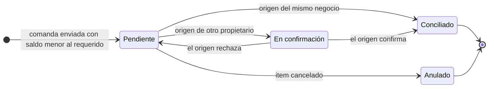

# Plan de refactorización — Almacenes Casa Pestalozzi

3 de noviembre de 2026 · Emilio Arriaga

> Plan de trabajo para el refactor de Almacenes. Rige junto con `CLAUDE.md` y `docs/arquitectura.md`: si algo de aquí contradice la arquitectura, primero se actualiza la arquitectura (§5 y §6) y después el código.

## Resumen y decisiones confirmadas

El refactor se hace en tres fases sobre el motor de Almacenes existente, sin crear un motor paralelo:

1. Cada producto del menú declara si es *preparado* o *reventa*.
2. Un faltante de insumos ya no frena la comanda; el administrador declara después de qué almacén salió.
3. El subagente `ux-ui` baja el peso visual de las tarjetas de selección de almacenes.

| Tema | Decisión de negocio |
| --- | --- |
| Clasificación | El menú tiene dos tipos: **preparado al momento** (receta, p.ej. copa de 150 ml) y **reventa** (descuenta piezas, p.ej. botella). **Ingrediente** es un tipo de artículo de almacén que solo se consume a través de recetas. |
| Copa y botella | La copa descuenta una fracción de la misma botella: un solo saldo por vino. |
| Momento del faltante | La venta nunca se bloquea. El faltante queda pendiente de origen y el admin lo concilia en el panel, con aviso en el buzón. |
| Saldo mientras está pendiente | El almacén queda en 0 y el resto se registra como faltante. El saldo nunca es negativo. |
| Origen permitido | Cualquier almacén registrado. Si es de otro propietario (p.ej. Almacén Central de Global), se genera una transferencia que el dueño del origen confirma. |
| Conciliación | Se puede dividir entre varios almacenes. No hay opción de compra directa ni de diferencia de inventario. |
| Productos existentes | Sugerencia automática de tipo y revisión manual (estado «por confirmar»). |
| UX/UI | Las tarjetas de «Almacenes en consulta» tienen más peso visual del que les corresponde. |

## Estado actual del código

Casi todo lo que se necesita ya existe; el cambio de fondo es qué hace la venta cuando falta saldo. Revisado en `main` de `AlexCayd/casa-pestalozzi-alx` el 3 de noviembre de 2026.

| Pieza | Dónde vive | Qué hace hoy | Qué cambia |
| --- | --- | --- | --- |
| Consumo de venta | `services/Pos/Comercial.php` → `Almacenes::consumirVenta()` → `ConsumoOferta::preparar()` | Descuenta al **enviar** la comanda, en la misma transacción. Si falla, la comanda no sale. | Descuenta lo disponible y registra el resto como faltante. |
| Rechazo por saldo | `Almacenes.php` línea ~263, `SALDO_INSUFICIENTE` | Sin negativos permitidos, la comanda se rechaza. Con negativos (Cocina), el saldo queda negativo. | Deja de aplicar a ventas. |
| Producción previa | `PresentacionesOferta::exigirExistenciasPrevias()` | Siempre bloquea con `PRODUCCION_PENDIENTE`. | Deja de bloquear: genera faltante como cualquier artículo. |
| Almacén de consumo | `oferta_consumos` + `AlmacenesConsumo` | Un almacén fijo por artículo y oferta, sin alternativo. | Se conserva: es el destino del faltante. |
| Composición | `recetas` / `receta_componentes` (legado) y `presentacion_versiones` / `presentacion_componentes` (M2) | Componentes `almacenado` o `desglosar`, con versiones inmutables y snapshot por item. | Reventa = presentación con un solo componente almacenado. |
| Capacidades del artículo | `articulo_configuraciones` | `comprable`, `componente`, `elaborable`, `almacenable`, `produccion_previa`, `costo_conocido`. | «Ingrediente» se expresa con `componente`; no hace falta otra columna. |
| Transferencias | `services/Inventory/Transferencias.php`, contrato M0.5-B | Solicitar, autorizar, enviar, recibir, rechazar, con historial e idempotencia. | Nuevo tipo *regularización* para conciliar con otro propietario. |
| Avisos | `buzon_notificaciones` | Bandeja por unidad con deduplicación. | Nuevo tipo de aviso de faltante. |

Unidades de artículo disponibles: `g`, `kg`, `ml`, `l`, `pza`; cantidades `DECIMAL(12,3)`. Según `CLAUDE.md`, cualquier cambio a un contrato compartido se justifica primero en `docs/arquitectura.md` §5.

## Fase 1 — Tipo de venta e ingredientes

Cada oferta gana un tipo de venta explícito; el motor de consumo no cambia porque ambos tipos se resuelven como composiciones que ya entiende.

| Tipo | Ejemplo | Cómo descuenta | Editor en Menú |
| --- | --- | --- | --- |
| Preparado al momento | Copa de vino 150 ml, pasta | Receta o presentación, como hoy | El actual de Presentaciones |
| Reventa | Botella de vino | Una presentación con **un solo** componente `almacenado` | Simplificado: artículo + cantidad por unidad vendida |
| Ingrediente (artículo, no producto) | Vino para la pasta, fresas | Solo como componente de recetas | Ficha de Artículos, capacidad `componente` |

Un mismo artículo puede ser ingrediente y reventa a la vez: la botella de vino se vende entera y también alimenta la copa.

### Modelo de datos

1. `ofertas_producto.tipo_venta ENUM('preparado','reventa') NOT NULL DEFAULT 'preparado'` y `tipo_venta_estado ENUM('sugerido','confirmado') NOT NULL DEFAULT 'confirmado'`.
2. `PresentacionesOferta` valida que una oferta de reventa publique exactamente un componente `almacenado`, etapa `servicio`, sin variantes que agreguen, quiten o sustituyan artículos; solo se permiten variantes de precio.
3. Las ofertas nuevas exigen elegir tipo al crearse; un producto de reventa no ofrece el editor de receta.
4. En Artículos, la capacidad `componente` se presenta como «Se usa como ingrediente». No se añade columna.

### Copa como fracción de la botella

Guardar el vino en `ml` y añadir `ingredientes.contenido_pieza DECIMAL(12,3) NULL` (750 para una botella). Entradas y conteos se capturan en botellas y se convierten; el saldo se muestra como «8 botellas + 450 ml». La botella de reventa descuenta 750 ml y la copa 150 ml.

Se descarta guardar en `pza` con copa = 0.200 pza: una copa de 125 ml daría 0.167 y seis copas sumarían 1.002 botellas por redondeo.

Restricción: el motor prohíbe cambiar la unidad de un artículo con composiciones históricas. Los vinos que ya existan en `pza` con historial necesitan un artículo nuevo en `ml` y una correspondencia, no una edición de unidad.

### Migración de productos existentes

1. Migración aditiva `database/actualizaciones/m3-tipo-venta.sql` y el mismo cambio en `ddl.sql` y `deploy.sql`. `menu-restaurante.sql` (los 112 originales) no se toca: la columna vive en la oferta.
2. Script de sugerencia: si la composición vigente es un solo componente `almacenado` en `pza` con cantidad 1 y la oferta no tiene ajustes de variantes sobre artículos, sugiere *reventa*; en cualquier otro caso, *preparado*. Todo queda en `sugerido`.
3. Menú administrativo: filtro «Tipo por confirmar» y confirmación en lote. Mientras esté en `sugerido`, el producto se vende con su comportamiento actual.
4. Panadería clasifica su menú igual; el consumo se activará cuando exista su POS, que sigue en backlog.

### Archivos principales

`services/Menu/Ofertas.php`, `services/Menu/PresentacionesOferta.php`, `services/Menu/Variantes.php`, `services/Menu/AdministracionMenu.php`, `controllers/AdminMenuController.php`, `views/admin/menu/form.php`, `index.php` y `variantes.php`, `services/Inventory/Articulos.php`, `views/admin/recetas/_articulo-configuracion.php`, y los tres scripts SQL.

### Aceptación

- [ ] Una botella de reventa vendida descuenta 750 ml del almacén de consumo.
- [ ] Una copa descuenta 150 ml del mismo artículo y saldo.
- [ ] Una oferta de reventa con dos componentes se rechaza al publicar.
- [ ] Guardar una variante que agregue un artículo a una botella se rechaza; una variante solo de precio se guarda.
- [ ] Tickets y snapshots anteriores se consultan y cancelan igual que antes.
- [ ] Los 112 productos originales quedan en `sugerido` sin cambiar precio, receta ni disponibilidad.

## Fase 2 — Faltantes y conciliación de origen

La comanda siempre sale: el almacén de consumo descuenta lo que tiene, queda en 0, y la diferencia se vuelve un faltante que el administrador asigna después a uno o varios almacenes de origen.

Ejemplo: Barra y Maridaje tiene 20 fresas y se venden 50. Se descuentan 20 (saldo 0) y nace un faltante de 30. El admin declara 20 de Refrigeración y 10 del Almacén Central; Refrigeración se aplica al instante y el Almacén Central espera la confirmación de Global.

### Flujo

1. **Venta.** En `Almacenes::operar('venta')`, por cada línea: `disponible = max(saldo, 0)`, se descuenta `min(disponible, requerido)` y el resto se inserta en `faltantes_inventario`. En ventas no se lanza `SALDO_INSUFICIENTE` ni `PRODUCCION_PENDIENTE`.
2. **Aviso.** Se crea o actualiza un aviso en `buzon_notificaciones` (tipo `inventario.faltante`, prioridad alta, `dedup_key` por almacén + artículo + día). Almacenes muestra un aviso «N faltantes por conciliar».
3. **Conciliar.** El admin con `inventario/editar` en el negocio destino abre la bandeja, ve artículo, almacén, cantidad, tickets de origen y fecha, y reparte la cantidad entre uno o varios almacenes. La suma debe ser exacta.
4. **Origen del mismo negocio.** En una sola transacción: transferencia de tipo *regularización* creada, enviada y recibida, y un movimiento `venta` en el destino ligado al `ticket_item`. El saldo del destino queda igual (entra y sale lo mismo) y el historial muestra de dónde vino.
5. **Origen de otro propietario.** Se crea la transferencia de regularización en estado `solicitada`. Al confirmarla, el dueño del origen ejecuta envío, recepción y consumo en una transacción. Si la rechaza, esa parte vuelve a pendiente con el motivo.
6. **Cancelación del item.** Si su faltante sigue pendiente, se anula y solo se compensa lo descontado. Si ya se concilió, la compensación regresa al almacén de consumo como hoy; la transferencia no se revierte.



Cada parte asignada sigue su propio camino: un faltante repartido entre Refrigeración y el Almacén Central queda conciliado solo cuando Global confirma su parte.

### Modelo de datos

| Tabla / cambio | Campos clave |
| --- | --- |
| `faltantes_inventario` (nueva) | `id`, `unidad_id`, `almacen_id` (destino), `articulo_id`, `ticket_item_id` (nulo en faltantes de migración), `operacion_id`, `origen` (`venta` / `migracion`), `cantidad`, `cantidad_conciliada`, `estado`, `version`, `creado_at` |
| `faltante_asignaciones` (nueva) | `faltante_id`, `almacen_origen_id`, `cantidad`, `transferencia_id`, `estado` (`aplicada` / `en_confirmacion` / `rechazada`), `actor_id` |
| `transferencias.tipo` | `ENUM('ordinaria','regularizacion') DEFAULT 'ordinaria'` |
| `movimientos_inventario` | Opcional `faltante_id` para trazar el consumo conciliado |
| `almacenes.permitir_negativos` | Se fija en 0 con un `CHECK` tras la migración (ver decisiones) |

`ticket_item_resoluciones` congela también la parte faltante del plan, para que un replay idempotente no genere un segundo faltante.

### Reglas

- Origen activo, con el artículo asociado y saldo suficiente **al confirmar**; nunca queda negativo. Si no alcanza, el admin reparte entre más almacenes; si ni la suma de todos cubre el faltante, queda pendiente hasta que se registre una entrada.
- Contraseña, CSRF, versión y clave idempotente, igual que Transferencias. Cada petición relee permisos.
- Global solo ve la identidad del destino, no su saldo. Un ID de faltante ajeno se rechaza.
- El costo del consumo conciliado es el de la línea de transferencia (costo del origen). El costo de venta del ticket no se recalcula.

### Archivos principales

`services/Inventory/Almacenes.php`, `services/Inventory/ConsumoOferta.php`, `services/Inventory/AdministracionAlmacenes.php`, nuevo `services/Inventory/Faltantes.php`, `services/Inventory/Transferencias.php`, `services/Menu/PresentacionesOferta.php`, `services/Security/Permisos.php` (rutas y APIs nuevas), `controllers/AdminAlmacenesController.php`, nueva vista `views/admin/almacenes/_faltantes.php`, `views/admin/almacenes/_almacenes.php`, `ddl.sql`, `deploy.sql` y migración `m4-faltantes.sql`.

### Aceptación

- [ ] Vender 50 con saldo 20 envía la comanda, deja saldo 0 y un faltante de 30.
- [ ] Conciliar 20 + 10 desde dos almacenes deja el faltante en `conciliado` y el historial completo.
- [ ] Una suma distinta de 30 o un origen sin saldo se rechazan sin cambios.
- [ ] Global confirma o rechaza; el rechazo devuelve la parte a pendiente.
- [ ] El replay de la misma comanda no duplica descuento ni faltante.
- [ ] Dos admins conciliando el mismo faltante a la vez: uno gana y el otro recibe conflicto de versión.
- [ ] Con 30 faltantes y 10 disponibles en total, la conciliación se rechaza y el faltante sigue pendiente; tras una entrada de 25, se concilia completo.
- [ ] Vender un artículo «Se elabora antes de vender» sin existencias envía la comanda y crea un faltante.
- [ ] Tras migrar no queda ningún saldo negativo, Cocina muestra sus faltantes pendientes y la pantalla ya no ofrece «Permitir existencias negativas».
- [ ] Conciliar desde un almacén con otro costo no cambia el costo del ticket ni el estado de resultados.

## Fase 3 — Peso visual de las tarjetas de selección

Las tarjetas de «Almacenes en consulta» son un filtro y hoy pesan como contenido: compiten con las existencias y con las alertas, que son lo que el operador viene a ver.

Hoy cada `.almacen-choice` mide mínimo 76 px de alto y 220 px de ancho, con borde, ícono repetido, nombre, estado, política de negativos y métricas, en una cuadrícula por propietario (`src/scss/admin/modules/inventario.scss`, líneas ~590–605, 672 y 731–732; markup en `views/admin/almacenes/index.php`, formulario `data-warehouse-selection`). El texto de política de negativos desaparece con la Fase 2.

### Lo que debe conseguir la pantalla

1. La selección se lee como control secundario; la tabla de existencias y el nuevo aviso de faltantes (Fase 2) quedan arriba en la jerarquía.
2. Con 7 almacenes en tres propietarios, la selección ocupa notablemente menos alto en escritorio y en móvil.
3. Se mantiene: casillas nativas, «Aplicar selección», estado de cambios pendientes, protección de la última casilla, foco visible y modo solo consulta.
4. Sistema administrativo blanco y negro, sin hex ni `rgba()` fuera de `_reset.scss` y `_globals.scss`, ambos temas.

### Instrucción para invocar al subagente

```text
Subagente ux-ui. Pantalla: Almacenes del panel (/admin/almacenes, /admin/global/almacenes,
/admin/panaderia/almacenes). Objetivo: bajar el peso visual de las tarjetas de "Almacenes en
consulta" (.almacen-choice) para que se lean como filtro y no como contenido; la tabla de
existencias y el aviso de faltantes deben ser lo primero. Archivos: views/admin/almacenes/index.php,
src/scss/admin/modules/inventario.scss, src/js/admin/inventario/inventario.js. Conservar casillas,
Aplicar selección, estado pendiente, última casilla protegida, teclado, solo consulta, ambos temas,
escritorio y móvil. Juzga jerarquía, tipografía y accesibilidad y decide si entra.
```

### Pruebas

`node scripts/tests/run-almacenes-selection-ui.cjs`, `node scripts/tests/run-almacenes-m11-ui.cjs` y `node scripts/tests/run-almacenes-auto-selection.cjs`, más `npm run build` revisando el diff de `gulp adminModuleCss`.

## Orden de ejecución, pruebas y riesgos

Fase 1 antes que Fase 2, porque la conciliación necesita saber qué descuenta cada producto; la Fase 3 puede ir en paralelo. Con el segundo parcial el 10 de noviembre y la entrega final el 4 de diciembre, conviene cerrar la Fase 1 antes del parcial.

1. Actualizar `docs/arquitectura.md` §5 y §6 con los dos contratos nuevos (tipo de venta y faltantes) y el retiro de negativos antes de tocar código.
2. Fase 1 en su rama: DDL + migración, validación en `PresentacionesOferta` y `Variantes`, editor de reventa, `contenido_pieza`, sugeridor y filtro «por confirmar».
3. Fase 2 en su rama: tablas, cambio en `operar('venta')` y en `exigirExistenciasPrevias()`, servicio `Faltantes`, transferencias de regularización, bandeja y aviso, permisos, retiro de negativos con su migración.
4. Fase 3: el subagente `ux-ui` revisa también el aviso de faltantes de la Fase 2, ya que comparte pantalla.
5. Actualizar `docs/modulos/almacenes.md`, `recetas.md`, `transferencias.md`, `docs/backlog.md` y `API.md` si hay endpoints nuevos.

### Pruebas

- Existentes: `npm run test:php`, `npm run test:js`, motor 3C con concurrencia (`run-almacenes-3c.php`, `run-almacenes-3c-concurrencia.php`), ensayos 3E y `run-articulos-m2.php`.
- Nuevas: `run-tipo-venta.php` (clasificación, reventa, variantes de precio, copa en ml, migración) y `run-faltantes.php` (faltante parcial, reparto, saldo total insuficiente, producción previa, rechazo Global, replay, cancelación, IDs ajenos, conflicto de versión, migración de negativos, costo congelado).
- Manual: escritorio, móvil, teclado, solo consulta y ambos temas en Menú y Almacenes.

### Riesgos

| Riesgo | Mitigación |
| --- | --- |
| Vinos ya registrados en `pza` con historial no pueden cambiar a `ml` | Artículo nuevo en `ml` + correspondencia; el anterior queda histórico |
| Al dejar de rechazar ventas, los faltantes se acumulan sin conciliar | Aviso de prioridad alta y contador visible en Almacenes y Finanzas |
| Cambiar `operar('venta')` rompe la idempotencia o el snapshot | El snapshot congela la parte faltante; pruebas de replay obligatorias |
| El costo de venta del ticket ya no coincide con el del origen conciliado | No se recalcula: el ticket conserva su costo congelado y la diferencia queda en el movimiento |
| La migración de negativos falla por el trigger `trg_almacen_no_desactivar_negativos` | Ajustar saldos a 0 y crear faltantes antes de poner `permitir_negativos = 0` |

## Decisiones incorporadas al refactor

Las cinco propuestas se aceptaron el 3 de noviembre de 2026 y entran en el alcance de las fases 1 y 2, cada una con su prueba de aceptación.

| Decisión | Implementación | Fase | Aceptación |
| --- | --- | --- | --- |
| Ningún almacén alcanza: el faltante queda pendiente | La bandeja muestra el saldo disponible por almacén y marca «Ningún almacén cubre este faltante». El aviso del buzón sigue abierto. Al registrar una entrada de ese artículo en cualquier almacén, el aviso se reactiva para conciliar. Archivos: `Faltantes.php`, `_faltantes.php`, `Almacenes::registrarEntrada()`. | 2 | Con 30 faltantes y 10 disponibles en total, la conciliación se rechaza y el faltante sigue pendiente; tras una entrada de 25, se concilia completo. |
| Producción previa también genera faltante | `exigirExistenciasPrevias()` deja de lanzar `PRODUCCION_PENDIENTE` al vender; el artículo elaborado sigue el mismo flujo de faltante. Actualizar la frontera M2 en `docs/modulos/almacenes.md` y `recetas.md`. | 2 | Vender un artículo «Se elabora antes de vender» sin existencias envía la comanda y crea un faltante. |
| Se retira «Permitir existencias negativas» | Se quita la casilla de crear y configurar almacén (`_almacenes.php`, `Almacenes.php`, `AdministracionAlmacenes.php`) y el texto de negativos de las tarjetas. Migración en `m4-faltantes.sql`, en este orden: por cada saldo negativo, un ajuste a 0 con motivo `migracion_faltantes` y un faltante pendiente por esa cantidad (`ticket_item_id` nulo, origen `migracion`); después `permitir_negativos = 0` en todos y un `CHECK` que lo fije. El orden importa porque `trg_almacen_no_desactivar_negativos` impide desactivar con negativos pendientes. La columna se conserva por compatibilidad. | 2 | Tras migrar no queda ningún saldo negativo, Cocina muestra sus faltantes pendientes y la pantalla ya no ofrece la opción. |
| Reventa sin variantes de artículos | `PresentacionesOferta` y `Variantes` rechazan, en ofertas de reventa, ajustes que agreguen, quiten o sustituyan artículos; solo se permiten variantes de precio. El sugeridor de la Fase 1 no propone reventa si la oferta ya tiene ajustes de artículos. | 1 | Guardar una variante que agregue un artículo a una botella se rechaza; una variante solo de precio se guarda. |
| El costo del ticket no se recalcula | Al conciliar, `ticket_items` y Finanzas conservan el costo congelado al enviar la comanda. El movimiento conciliado guarda el costo del origen, así la diferencia queda visible en el historial. | 2 | Conciliar desde un almacén con otro costo no cambia el costo del ticket ni el estado de resultados. |